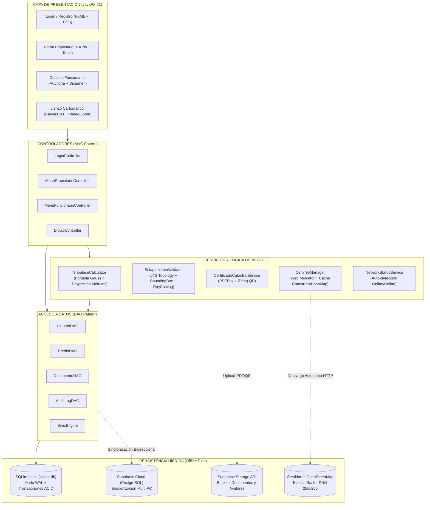
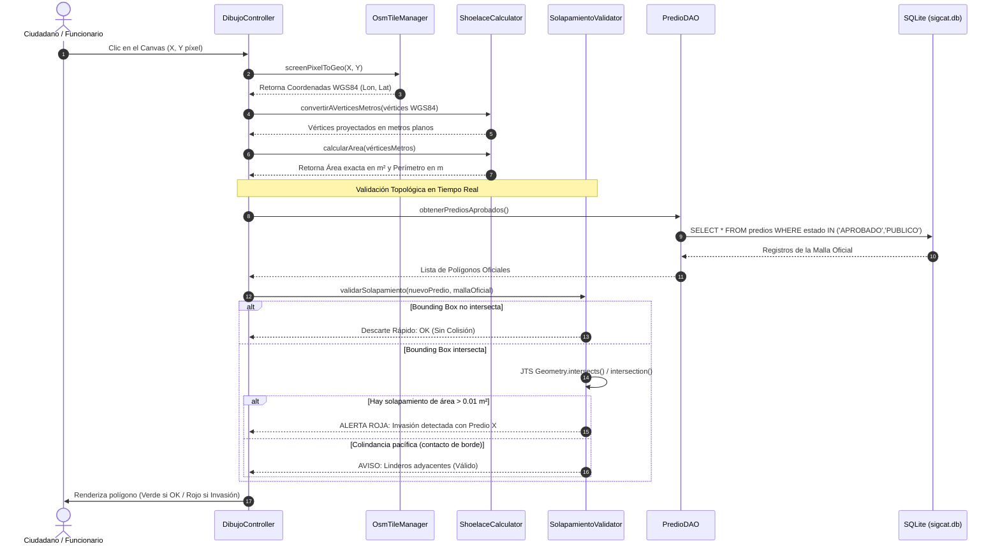

# 🏛️ SIGCAT — Guía Magna de Estudio y Documentación Oficial de Sustentación
## Sistema de Información Geográfica y Catastro Multipropósito de Sincelejo, Sucre
**Universidad Antonio José de Sucre (UNIAJS) — Facultad de Ingeniería**  
**Asignatura:** Ingeniería de Software | **Docente Evaluador:** Ing. Juan Manuel Palacio  
**Equipo de Proyecto:** Cristian Morales, Andrés Diaz, Leider Barreto, Aldo Ibañez, José Sánchez  

---

## 📑 Tabla de Contenidos
1. [Resumen Ejecutivo y Lógica de Negocio](#1-resumen-ejecutivo-y-lógica-de-negocio)
   * 1.1 El Problema Territorial en Sincelejo
   * 1.2 La Solución SIGCAT
   * 1.3 Stack Tecnológico del Sistema
2. [Arquitectura del Sistema y Flujo de Datos](#2-arquitectura-del-sistema-y-flujo-de-datos)
   * 2.1 Diagrama de Arquitectura y Componentes (Mermaid)
   * 2.2 Diagrama de Flujo: Consulta y Validación de un Predio
   * 2.3 Patrones de Diseño Aplicados
3. [División por Roles del Equipo y Defensa Individual](#3-división-por-roles-del-equipo-y-defensa-individual)
   * 3.1 Cristian Morales — Arquitecto de Software y Coordinador Técnico
   * 3.2 Andrés Diaz — Desarrollador Core y Lógica Geoespacial
   * 3.3 Leider Barreto — Diseñador UI/UX y Motor Cartográfico
   * 3.4 Aldo Ibañez — Desarrollador de Persistencia y Base de Datos
   * 3.5 José Sánchez — Ingeniero de Aseguramiento de Calidad (QA) y Pruebas
4. [Materiales de Apoyo Visual y Defensa Técnica](#4-materiales-de-apoyo-visual-y-defensa-técnica)
   * 4.1 Matriz Comparativa de Decisiones de Arquitectura
   * 4.2 Puntos Fuertes del Proyecto (Argumentos de Cierre)
   * 4.3 Glosario Técnico Clave para Jurados

---

# 1. Resumen Ejecutivo y Lógica de Negocio

### 1.1 El Problema Territorial en Sincelejo
En el municipio de Sincelejo (Código DANE: 70001), al igual que en gran parte de Colombia, la gestión del catastro físico y jurídico ha dependido históricamente de planos en papel, archivos DWG/DXF desarticulados y bases de datos alfanuméricas aisladas. Esta desconexión genera **tres graves problemáticas**:
1. **Solapamiento Topológico de Linderos:** Predios privados colindantes cuyas escrituras reclaman la misma porción de suelo, provocando litigios civiles prolongados.
2. **Invasión de Bienes Públicos e Institucionales:** Trazados catastrales que invaden o se sobreponen a áreas de reserva, vías o patrimonio histórico y municipal (como el Parque Santander, la Catedral San Francisco de Asís o la Alcaldía Municipal).
3. **Falta de Trazabilidad y Seguridad Documental:** Ausencia de validación criptográfica sobre las escrituras notariales y falta de auditoría forense sobre qué funcionario aprobó o modificó un predio y bajo qué dictamen técnico.

### 1.2 La Solución SIGCAT
**SIGCAT** es una plataforma de software de escritorio nativa que moderniza el ciclo de vida catastral bajo el paradigma del **Catastro Multipropósito (Ley 1955 de 2019 / Conpes 3958)**.

* **Georreferenciación en Tiempo Real:** El ciudadano radica su solicitud dibujando su predio directamente sobre la cartografía urbana y rural oficial de Sincelejo mediante OpenStreetMap.
* **Cálculo Métrico Real:** Transforma automáticamente las coordenadas angulares GPS (WGS84) a metros planos locales y calcula el área real en metros cuadrados ($m^2$) usando la fórmula del agrimensor (Gauss / Shoelace).
* **Prevención Activa de Solapamientos:** Un motor topológico basado en **JTS (Java Topology Suite)** analiza el polígono dibujado contra toda la malla catastral municipal antes de radicar. Si hay colisión con predios públicos o aprobados, el sistema **bloquea la radicación** e informa los metros de invasión.
* **Consola de Dictamen para Funcionarios:** La Alcaldía examina las solicitudes, inspecciona los linderos, revisa las escrituras PDF vinculadas y emite un concepto motivado vinculante.
* **Certificado Catastral con QR y Hash Forense:** Al aprobarse, genera un certificado PDF oficial firmado digitalmente con hash SHA-256 y un código QR que enlaza a la nube de Supabase para validación pública.

### 1.3 Stack Tecnológico del Sistema

| Tecnología / Librería | Versión | Tipo | Función Específica en SIGCAT |
| :--- | :---: | :---: | :--- |
| **Java SE (OpenJDK)** | 17 LTS | Lenguaje Core | Plataforma base corporativa orientada a objetos, tipado estricto, memoria administrada y multihilo. |
| **JavaFX** | 21.0.2 | Interfaz Gráfica (GUI) | Motor de vistas moderno, desacoplado mediante FXML y estilizado con CSS personalizado en tema oscuro. |
| **JavaFX Canvas** | 21 | Renderizado Cartográfico | Lienzo 2D de alto rendimiento para pintar teselas rasterizadas y polígonos vectoriales sin WebView. |
| **SQLite (Xerial JDBC)** | 3.53.4.0 | Motor de Base de Datos Local | Almacenamiento local *Offline-First* con transacciones ACID, modo WAL concurrente y claves foráneas activas. |
| **PostgreSQL (Supabase)** | 15+ | Base de Datos en la Nube | Repositorio centralizado para sincronización remota multi-terminal y respaldo institucional. |
| **Supabase Storage API** | REST / v1 | Almacenamiento de Objetos | Repositorio en la nube para expedientes notariales, recibos PDF y avatares de usuario. |
| **JTS Topology Suite** | 1.20.0 | Motor Geoespacial | Algoritmos de predicados espaciales DE-9IM, cálculo de intersecciones y detección de autointersecciones. |
| **Apache PDFBox** | 2.0.31 | Procesamiento de Documentos | Generación dinámica de certificados catastrales oficiales en formato PDF vectorial. |
| **ZXing ("Zebra Crossing")** | 3.5.3 | Criptografía / Códigos 2D | Generación de matrices QR de verificación incrustadas en los certificados oficiales. |
| **jBCrypt** | 0.4 | Seguridad Criptográfica | Algoritmo de hashing adaptativo con factor de costo 12 para credenciales de acceso (RNF-01). |
| **Apache Maven** | 3.6.3+ | Gestión de Dependencias y Build | Compilación reproducible, ejecución de suite de pruebas y empaquetado Fat JAR con Maven Shade Plugin. |
| **JUnit Jupiter (JUnit 5)**| 5.10.2 | Aseguramiento de Calidad | Batería de 41 pruebas automatizadas (unitarias, geométricas, criptográficas y de integración). |

---

# 2. Arquitectura del Sistema y Flujo de Datos

### 2.1 Diagrama de Arquitectura y Componentes
SIGCAT implementa una arquitectura híbrida desacoplada en 4 niveles: **Capa de Presentación**, **Capa de Servicios y Negocio Core**, **Capa de Acceso a Datos (DAO)** y **Capa de Persistencia Híbrida (Offline-First)**.

### 2.2 Diagrama de Flujo: Consulta y Validación de un Predio
El siguiente diagrama detalla qué ocurre milisegundo a milisegundo desde que el usuario hace clic sobre el mapa de Sincelejo hasta que el sistema determina si el lote es legal o colisiona:

### 2.3 Patrones de Diseño Aplicados
1. **Model-View-Controller (MVC):** Desacopla la lógica de presentación (archivos FXML y estilos CSS) de la lógica de control (`controllers/`) y de las entidades del dominio (`models/`).
2. **Data Access Object (DAO):** Abstrae y encapsula todo el acceso a la base de datos. Si el día de mañana se cambia SQLite por Oracle, los controladores no sufren ningún cambio.
3. **Singleton Pattern:** Utilizado en `DatabaseConnection`, `DatabaseConnectionSupabase`, `NetworkStatusService` y `SupabaseRealtimeService` para garantizar una única instancia compartida y controlada de conexiones y recursos de red.
4. **Strategy / Service Pattern:** Aislado en `SupabaseStorageService`, `CertificadoCatastralService` y `ShoelaceCalculator`, permitiendo probar algoritmos de forma independiente y aislada de la interfaz gráfica.
5. **Offline-First:** La aplicación opera de forma 100% autónoma sobre SQLite local; cuando detecta conexión a internet, sincroniza automáticamente con PostgreSQL en Supabase Cloud.

---

# 3. División por Roles del Equipo y Defensa Individual

---

## 3.1 Cristian Morales — Arquitecto de Software y Coordinador Técnico

### 📋 Aporte Técnico y Profesional (Memoria Técnica)
* **Arquitectura del Sistema y Gobernanza Técnica:** Diseño de la arquitectura de 4 capas y establecimiento del estándar de codificación, estructura de paquetes y control de versiones con Git/GitHub.
* **Persistencia Concurrente y Estrategia Multi-PC:** Configuración del motor de persistencia local SQLite en [`DatabaseConnection.java`](file:///c:/Proyectos%20DEV_/Proyectos%20de%20U/Ingenieria%20de%20Software/src/main/java/com/sigcat/utils/DatabaseConnection.java) mediante directivas de concurrencia:
  * `PRAGMA journal_mode = WAL;` (Write-Ahead Logging): Permite que múltiples lectores lean concurrentemente sin bloquear al hilo que está escribiendo.
  * `PRAGMA busy_timeout = 5000;`: Evita el error `SQLITE_BUSY` cuando dos estaciones de trabajo guardan simultáneamente en red local.
* **Navegación Fluida sin Parpadeo:** Creación de [`ViewNavigator.java`](file:///c:/Proyectos%20DEV_/Proyectos%20de%20U/Ingenieria%20de%20Software/src/main/java/com/sigcat/utils/ViewNavigator.java), solucionando el problema de saltos visuales y recreación de ventanas mediante el intercambio dinámico de nodos raíz (`scene.setRoot()`) preservando el estado maximizado del `Stage`.
* **Seguridad y Cifrado (RNF-01):** Implementación de [`PasswordUtil.java`](file:///c:/Proyectos%20DEV_/Proyectos%20de%20U/Ingenieria%20de%20Software/src/main/java/com/sigcat/security/PasswordUtil.java) con el algoritmo criptográfico adaptativo **BCrypt** (factor de trabajo $2^{12} = 4096$ iteraciones con sal aleatoria criptográfica).
* **Empaquetado y Distribución:** Configuración del `maven-shade-plugin` en `pom.xml` y la clase puente [`MainLauncher.java`](file:///c:/Proyectos%20DEV_/Proyectos%20de%20U/Ingenieria%20de%20Software/src/main/java/com/sigcat/app/MainLauncher.java) para empaquetar un Fat JAR portable redistribuible de 30.4 MB ejecutable con un solo clic.

### 🎙️ Explicación en Lenguaje Natural (Analógica)
> *"Mi rol en SIGCAT fue el de **Arquitecto de Obra y Director de Seguridad**. Imaginen que construir un software es como edificar un edificio inteligente: si los cimientos y las tuberías están mal diseñados, el edificio colapsa aunque la pintura sea bonita.  
> Yo diseñé las tuberías maestras: aseguré que si entran 5 personas al mismo tiempo a radicar predios, la base de datos no se trabe como una puerta estrecha, sino que funcione como una autopista con varios carriles (modo WAL).  
> Además, me aseguré de que las llaves de seguridad fueran impenetrables: ninguna contraseña viaja ni se guarda en texto claro; aplicamos un triturador matemático llamado BCrypt que transforma una clave simple como '123' en una huella digital irreversible de 60 caracteres."*

### 🎓 Simulación de Sustentación (Preguntas de Jurado)

#### Pregunta 1 (Trampa / Concurrencia):
> **Docente:** *"SQLite es conocida por ser una base de datos monousuario que bloquea todo el archivo al escribir. ¿Cómo garantizan ustedes que SIGCAT soporte un entorno multiusuario de oficina catastral sin que la aplicación se congele?"*
> 
> **Respuesta de Cristian:**  
> *"Excelente pregunta, profesor. Por defecto, SQLite opera en modo `DELETE rollback journal`, que bloquea la base de datos completa durante una transacción de escritura. Sin embargo, en `DatabaseConnection.java` nosotros activamos explícitamente el modo **WAL (Write-Ahead Logging)** con `PRAGMA journal_mode = WAL`.  
> En modo WAL, los cambios se escriben en un archivo auxiliar append-only separado (`.wal`), lo que permite concurrencia real: **múltiples lectores pueden consultar simultáneamente mientras un escritor redacta en el log**, sin bloquearse entre sí. Además, configuramos `PRAGMA busy_timeout = 5000`, lo que le da al motor un margen de espera de hasta 5 segundos para adquirir el candado de escritura antes de lanzar una excepción, garantizando estabilidad en red de área local (LAN)."*

#### Pregunta 2 (Arquitectura / Patrones):
> **Docente:** *"En JavaFX es muy común ver código donde el controlador de la interfaz ejecuta directamente consultas SQL. ¿Cómo desacoplaron ustedes esa responsabilidad en SIGCAT?"*
> 
> **Respuesta de Cristian:**  
> *"Aplicamos rigurosamente el principio de responsabilidad única (SRP) y el patrón **DAO (Data Access Object)**. Los controladores de JavaFX solo interactúan con interfaces de servicio y DAOs (`PredioDAO`, `UsuarioDAO`).  
> El controlador nunca escribe una instrucción SQL como `SELECT` o `INSERT`, ni sabe si los datos vienen de un archivo SQLite local o de PostgreSQL en Supabase. El controlador solo recibe y envía objetos del modelo (`Predio`, `Usuario`). De esta forma, si la alcaldía decide migrar la base de datos a Oracle o MariaDB, los controladores de interfaz no requieren cambiar ni una sola línea de código."*

#### Pregunta 3 (Empaquetado / Java Modules):
> **Docente:** *"A partir de Java 11 y JavaFX 21, JavaFX ya no viene incluido en el JDK. ¿Por qué crearon una clase `MainLauncher` separada de `App` para generar el JAR?"*
> 
> **Respuesta de Cristian:**  
> *"Es un requerimiento técnico fundamental del lanzador de Java. Si la clase principal que tiene el método `main` hereda directamente de `javafx.application.Application`, la Máquina Virtual de Java (JVM) verifica antes de iniciar si los módulos de JavaFX están en el ModulePath. Al empaquetar un Fat JAR sombreado (*uber-jar*), todas las clases residen en el Classpath tradicional.  
> Si se ejecuta directo sobre la clase `Application`, la JVM se detiene con el error `JavaFX runtime components are missing`. Al crear `MainLauncher` como una clase Java pura estándar cuyo `main` invoca `Application.launch(App.class, args)`, la JVM inicia normalmente y carga el entorno gráfico dinámicamente sin requerir configuraciones de `--module-path` en la máquina del cliente."*

---

## 3.2 Andrés Diaz — Desarrollador Core y Lógica Geoespacial

### 📋 Aporte Técnico y Profesional (Memoria Técnica)
* **Motor Métrico de Superficie:** Desarrollo de [`ShoelaceCalculator.java`](file:///c:/Proyectos%20DEV_/Proyectos%20de%20U/Ingenieria%20de%20Software/src/main/java/com/sigcat/geometry/ShoelaceCalculator.java), implementando la **Fórmula del Agrimensor (Algoritmo de Gauss / Shoelace)**:
  $$\text{Área} = \frac{1}{2} \left| \sum_{i=1}^{n-1} (x_i y_{i+1} - x_{i+1} y_i) + (x_n y_1 - x_1 y_n) \right|$$
* **Proyección Geodésica Métricas Reales:** Implementación del método `convertirAVerticesMetros()`. Como las coordenadas del mapa están en grados angulares WGS84 (`[lon, lat]`), convirtió dichas coordenadas a distancias euclidianas ortogonales locales basadas en el elipsoide de referencia WGS84 para la latitud de Sincelejo ($9.30^\circ\text{ N}$):
  $$\Delta x = \Delta\text{lon} \cdot \left(\frac{\pi}{180}\right) \cdot R \cdot \cos(\text{lat}_{\text{rad}}), \quad \Delta y = \Delta\text{lat} \cdot \left(\frac{\pi}{180}\right) \cdot R$$
  Esto garantiza que el área calculada refleje **metros cuadrados reales ($m^2$)** y no unidades arbitrarias de pantalla.
* **Motor de Validación Topológica Multi-Nivel:** Implementación de [`SolapamientoValidator.java`](file:///c:/Proyectos%20DEV_/Proyectos%20de%20U/Ingenieria%20de%20Software/src/main/java/com/sigcat/geometry/SolapamientoValidator.java) articulado con la librería **JTS Topology Suite 1.20**:
  1. *Filtro Rápido por Bounding Box (AABB):* Descarta cálculos pesados en $O(1)$ si las cajas de linderos no se tocan.
  2. *Intersección Vectorial Estricta (DE-9IM):* Cálculo de la geometría de intersección $G_{\text{nuevo}} \cap G_{\text{malla}}$. Si el área resultante supera el umbral de tolerancia topológica ($0.01\text{ m}^2$), se marca como solapamiento.
  3. *Distinción de Colindancia Pacífica:* Si la intersección es una línea o un punto (dimensión $\le 1$), se valida como lindero compartido legal y **no** se genera falsa alarma.
  4. *Detección de Autointersecciones (Polígonos Complejos):* Valida `polygon.isValid()` impidiendo que el usuario guarde figuras en forma de lazo o de "8".
  5. *Algoritmo de Ray-Casting:* Detección de inclusión total (cuando un lote queda completamente sumergido dentro de otro).

### 🎙️ Explicación en Lenguaje Natural (Analógica)
> *"Mi rol en el proyecto fue ser el **Geómetra y Árbitro de Línea de SIGCAT**.  
> Para entender lo que hice, piensen en dos cosas cotidianas:  
> Primero, cuando compramos un terreno, a nadie le cobran en 'grados de latitud y longitud', nos cobran en **metros cuadrados reales**. Mi código toma los clics del mouse sobre las calles de Sincelejo, hace una corrección matemática por la curvatura de la Tierra a la altura de Sucre, y calcula con absoluta exactitud el tamaño del predio como si hubiésemos estirado una cinta métrica.  
> Segundo, imaginen que la cartografía de Sincelejo es un rompecabezas donde cada ficha es un terreno aprobado. Mi validador topológico es el árbitro que no permite que nadie ponga una ficha encima de otra. Si dos vecinos comparten la misma barda o cerca, el árbitro dice: 'Perfecto, son vecinos'. Pero si alguien intenta meter su cerca 50 centímetros dentro del patio del vecino, el sistema pita la falta, pinta el terreno de rojo y le dice exactamente cuántos metros está invadiendo."*

### 🎓 Simulación de Sustentación (Preguntas de Jurado)

#### Pregunta 1 (Matemática / Proyecciones):
> **Docente:** *"Si la Tierra es un geoide esférico tridimensional, ¿por qué pudieron utilizar el algoritmo plano de Shoelace para calcular las áreas de los predios?"*
> 
> **Respuesta de Andrés:**  
> *"Profesor, la fórmula de Shoelace se define en un plano bidimensional euclidiano cartesiano. Si aplicáramos Shoelace directamente sobre los grados de longitud y latitud, obtendríamos 'grados cuadrados', lo cual carece de sentido físico y métrico catastral.  
> Para solucionar esto, implementé en `ShoelaceCalculator.java` una **proyección conforme local simplificada basada en el radio medio de la Tierra ($R \approx 6,371,000\text{ m}$)**. Proyectamos la longitud considerando el factor de escala $\cos(\text{latitud})$, evaluado en la latitud específica de Sincelejo ($\approx 9.30^\circ$).  
> Dado que los predios urbanos y suburbanos abarcan extensiones menores a varios kilómetros cuadrados, la curvatura terrestre en esa escala introduce un error infinitesimal menor al $0.05\%$, el cual cumple sobradamente la tolerancia del Instituto Geográfico Agustín Codazzi (IGAC) para levantamientos urbanos."*

#### Pregunta 2 (Complejidad Algorítmica / Optimización):
> **Docente:** *"Si Sincelejo tuviera 50,000 predios registrados, comparar el predio nuevo contra todos los demás tomaría demasiado tiempo. ¿Qué técnica implementó para no ralentizar el sistema?"*
> 
> **Respuesta de Andrés:**  
> *"Implementé una optimización en dos fases basada en **Bounding Boxes (Cajas Envolventes Mínimas)**.  
> La validación de intersección topológica poligonal mediante JTS es computacionalmente costosa ($O(V \log V)$ donde $V$ es el número de vértices). Comparar 50,000 polígonos así bloquearía la interfaz.  
> Por ello, la primera fase es un filtro rápido de complejidad $O(1)$: calculamos el `Envelope` $[x_{\min}, x_{\max}, y_{\min}, y_{\max}]$ del predio nuevo y lo comparamos contra el `Envelope` de los predios existentes mediante simples comparaciones de números flotantes. El $99.9\%$ de los predios de la ciudad que están lejos se descartan instantáneamente. Únicamente los predios cuyas cajas envolventes se tocan pasan a la segunda fase de evaluación poligonal profunda con JTS."*

#### Pregunta 3 (Casos Extremos / Edge Cases):
> **Docente:** *"¿Qué pasa si un usuario dibuja un predio legal que comparte exactamente el mismo lindero con el vecino? ¿El sistema lo detecta como solapamiento y lo bloquea?"*
> 
> **Respuesta de Andrés:**  
> *"Ese fue uno de los casos extremos más importantes que resolvimos y verificamos con pruebas unitarias en `SolapamientoValidatorTest`.  
> Si dos predios colindantes comparten una arista o cerca común, la intersección geométrica resultante no es un polígono con área, sino un segmento lineal (`LineString`) o puntos (`Point`).  
> En `SolapamientoValidator.java`, nosotros no solo verificamos `geomA.intersects(geomB)`, sino que obtenemos la geometría intersección `Geometry inter = geomA.intersection(geomB)` y evaluamos su dimensión y área real: `if (inter.getArea() > 0.01)`. Si la intersección es una línea o un punto, el área es $0.00\text{ m}^2$, por lo que el algoritmo clasifica la operación como **Colindancia Válida (Adyacencia)** y permite guardar el predio sin emitir falsa alarma."*

---

## 3.3 Leider Barreto — Diseñador UI/UX y Motor Cartográfico

### 📋 Aporte Técnico y Profesional (Memoria Técnica)
* **Motor Cartográfico OpenStreetMap 100% Nativo:** Desarrollo completo de [`OsmTileManager.java`](file:///c:/Proyectos%20DEV_/Proyectos%20de%20U/Ingenieria%20de%20Software/src/main/java/com/sigcat/map/OsmTileManager.java). Renderiza la cartografía de Sincelejo directamente sobre un `Canvas` de JavaFX sin utilizar navegadores web embebidos (`WebView`), HTML ni librerías JavaScript como Leaflet.
* **Proyección Web Mercator (EPSG:3857):** Implementación de las funciones trigonométricas de transformación geoespacial para convertir coordenadas esféricas `[latitud, longitud]` en índices de teselas $(X, Y)$ y desplazamientos de píxeles en pantalla:
  $$x_{\text{tile}} = \left\lfloor \frac{\text{lon} + 180}{360} \cdot 2^{\text{zoom}} \right\rfloor, \quad y_{\text{tile}} = \left\lfloor \left( 1 - \frac{\ln(\tan(\text{lat}_{\text{rad}}) + \sec(\text{lat}_{\text{rad}}))}{\pi} \right) \cdot 2^{\text{zoom}-1} \right\rfloor$$
* **Descarga Concurrente Asíncrona y Caché de Memoria:**
  * Uso de un pool de hilos daemon con `ExecutorService` para la descarga HTTP multihilo de imágenes PNG ($256\times256\text{ px}$) desde los servidores de OpenStreetMap sin congelar el hilo principal de la interfaz (`JavaFX Application Thread`).
  * Implementación de una caché en memoria basada en `ConcurrentHashMap<String, Image>` para que las teselas descargadas se sirvan inmediatamente al navegar o regresar.
* **Georreferenciación Bidireccional Interactiva:**
  * Algoritmo `screenPixelToGeo(px, py)`: transforma el clic del cursor del mouse sobre el Canvas en la coordenada exacta de longitud y latitud en Sincelejo.
  * Algoritmo `geoToScreenPixel(lon, lat)`: ancla los vértices del predio a las calles reales, logrando que los polígonos no se desfasen ni se distorsionen cuando el usuario hace paneo (arrastrar con el mouse) o zoom (con la rueda del ratón).
* **Diseño Visual e Interfaces Responsivas:** Construcción de las 7 vistas FXML con tema dark corporativo institucional (`#0f172a`), semaforización de estados (`APROBADO` verde, `PENDIENTE` naranja, `RECHAZADO` rojo) y diseño ergonómico de paneles para cada rol.

### 🎙️ Explicación en Lenguaje Natural (Analógica)
> *"Mi función en el proyecto fue ser el **Cartógrafo Digital y Diseñador de Experiencia de Usuario**.  
> Muchas personas cuando necesitan poner un mapa en una aplicación de Java recurren al camino fácil: incrustar una página web dentro del programa. Nosotros decidimos hacer algo mucho más rápido, liviano y profesional: construimos un motor de mapa nativo en Java puro.  
> ¿Cómo funciona? Imaginen que el mapa de Sincelejo es un gigantesco mosaico compuesto por miles de baldosas cuadradas pequeñas (teselas). Mi código calcula exactamente qué baldosas de Sincelejo estás mirando según el nivel de aumento, las descarga de internet en segundo plano con varios mensajeros trabajando al tiempo (hilos), y las pinta sobre el lienzo sin que la pantalla se trabe ni un solo milisegundo.  
> Además, logré que los terrenos dibujados queden 'clavados' en el asfalto virtual de Sincelejo: si usted arrastra el mapa hacia Majagual o hace zoom en la Universidad de Sucre, el terreno se mueve y escala de forma perfectamente coordinada con las calles."*

### 🎓 Simulación de Sustentación (Preguntas de Jurado)

#### Pregunta 1 (UI/UX / Rendimiento Gráfico):
> **Docente:** *"JavaFX incluye el componente `WebView` que permite incrustar un navegador web y cargar Google Maps o Leaflet con pocas líneas de código. ¿Por qué decidieron complicarse la vida programando un motor de teselas sobre un `Canvas`?"*
> 
> **Respuesta de Leider:**  
> *"Esa fue una de las decisiones de diseño más estratégicas de nuestro proyecto, profesor.  
> Incrustar un `WebView` en JavaFX implica cargar el motor WebKit completo dentro de la JVM. Esto consume entre 250 MB y 400 MB adicionales de memoria RAM, vuelve la aplicación pesada y genera un desfase de coordenadas muy difícil de sincronizar entre eventos JavaScript del navegador y eventos Java de escritorio.  
> Al renderizar nativamente sobre un `Canvas` de JavaFX con `OsmTileManager`, el consumo de memoria se mantiene por debajo de 60 MB, la velocidad de dibujado alcanza 60 fotogramas por segundo (FPS) gracias a la aceleración por hardware de JavaFX (Prism/DirectX), y tenemos control matemático absoluto y directo sobre cada píxel y coordenada sin capas intermedias."*

#### Pregunta 2 (Concurrencia / JavaFX Thread):
> **Docente:** *"Al navegar por el mapa se descargan muchas imágenes de internet. Si una imagen tarda en descargar por lentitud de la red, ¿por qué no se congela la interfaz del usuario?"*
> 
> **Respuesta de Leider:**  
> *"Porque implementamos una arquitectura estrictamente asíncrona basada en el principio fundamental de JavaFX: **jamás bloquear el `JavaFX Application Thread`**.  
> En `OsmTileManager.java`, la descarga de cada tesela se delega a un `ExecutorService` con un pool de hilos de fondo (*daemon threads*). Mientras las imágenes bajan de la red, el hilo de la interfaz continúa atendiendo los clics y el paneo del usuario con fluidez total.  
> En el instante en que un hilo termina de descargar la imagen, la almacena en nuestro `ConcurrentHashMap` de caché y solicita un redibujado programado en el hilo de la interfaz mediante `Platform.runLater()`. Si no hay internet, el motor no se rompe: dibuja una cuadrícula base y avisa discretamente sin arrojar errores al usuario."*

#### Pregunta 3 (Transformación de Coordenadas):
> **Docente:** *"Explíqueme conceptualmente qué hace el método `screenPixelToGeo` cuando un usuario hace clic en el mapa."*
> 
> **Respuesta de Leider:**  
> *"El método realiza la **transformación inversa de Web Mercator**.  
> Cuando el usuario hace clic, el evento del mouse entrega coordenadas en píxeles de pantalla $(x, y)$ relativos a la esquina superior izquierda del Canvas.  
> El método toma esos píxeles, le suma el desplazamiento actual del paneo de la cámara y divide la distancia entre el factor de escala que depende del nivel de zoom actual ($256 \cdot 2^{\text{zoom}}$).  
> A partir de esa fracción normalizada de la Tierra, se despeja la longitud linealmente y se aplica la inversa de la función Gudermanniana con arco-tangente y exponenciales para despejar la latitud esférica, retornando una coordenada angular exacta $[ \text{lon}, \text{lat} ]$ en el sistema geodésico WGS84 lista para ser guardada en la base de datos."*

---

## 3.4 Aldo Ibañez — Desarrollador de Persistencia y Base de Datos

### 📋 Aporte Técnico y Profesional (Memoria Técnica)
* **Modelo Relacional Normalizado:** Diseño del esquema de base de datos relacional para el catastro municipal con normalización en 3ra Forma Normal (3FN), estructurado en tablas maestras:
  * `usuarios`: Autenticación, roles restringidos por integridad (`CHECK(rol IN ('PROPIETARIO', 'FUNCIONARIO', 'ADMIN'))`) y datos de contacto.
  * `predios`: Información alfanumérica catastral, área calculada, propietario, funcionario dictaminador y estado del trámite (`PENDIENTE`, `APROBADO`, `RECHAZADO`).
  * `vertices`: Almacenamiento granular de las coordenadas geográficas de cada lindero, vinculadas al predio mediante clave foránea con integridad referencial en cascada (`ON DELETE CASCADE`).
  * `documentos`: Vínculo del expediente probatorio, ruta en storage, URL pública y firma SHA-256.
  * `audit_log`: Registro inmutable de trazabilidad y auditoría de cambios de estado.
* **Transacciones ACID y Operaciones por Lotes (*Batching*):** En [`PredioDAO.java`](file:///c:/Proyectos%20DEV_/Proyectos%20de%20U/Ingenieria%20de%20Software/src/main/java/com/sigcat/dao/PredioDAO.java), implementación de control transaccional explícito:
  * Desactivación de auto-confirmación (`conn.setAutoCommit(false)`).
  * Inserción del predio seguida de la inserción de $N$ vértices mediante `stmt.addBatch()` y `stmt.executeBatch()`, reduciendo las operaciones de I/O en disco de $N$ accesos a 1 solo acceso atómico.
  * Captura de excepciones con `conn.rollback()` para garantizar que jamás quede un predio guardado sin vértices o con geometrías incompletas.
* **Migración Automática de Esquema:** Desarrollo de la rutina en [`DatabaseInitializer.java`](file:///c:/Proyectos%20DEV_/Proyectos%20de%20U/Ingenieria%20de%20Software/src/main/java/com/sigcat/utils/DatabaseInitializer.java) que detecta restricciones antiguas en bases SQLite existentes y realiza una migración segura en caliente (`PRAGMA foreign_keys=OFF`, clonación temporal y reemplazo atómico) sin pérdida de datos históricos.
* **Sincronización Híbrida con Supabase:** Integración con PostgreSQL remoto a través de [`DatabaseConnectionSupabase.java`](file:///c:/Proyectos%20DEV_/Proyectos%20de%20U/Ingenieria%20de%20Software/src/main/java/com/sigcat/supabase/DatabaseConnectionSupabase.java) y [`DocumentoDAO.java`](file:///c:/Proyectos%20DEV_/Proyectos%20de%20U/Ingenieria%20de%20Software/src/main/java/com/sigcat/dao/DocumentoDAO.java) con fallback transparente: si no hay red, lee y escribe en SQLite; al haber red, sincroniza con PostgreSQL en la nube.

### 🎙️ Explicación en Lenguaje Natural (Analógica)
> *"Mi rol en el proyecto fue ser el **Notario y Custodio de la Base de Datos de SIGCAT**.  
> Cuando un ciudadano o funcionario registra un predio, no solo estamos guardando un texto común; estamos guardando los límites legales de una propiedad con sus coordenadas exactas. Si el computador se apagara en la mitad del guardado, no podemos permitir que se guarde el nombre del dueño pero se pierdan las esquinas del terreno.  
> Por eso apliqué una regla de oro llamada **Transacciones ACID**: el guardado es 'todo o nada'. O se guardan el predio y todos sus vértices de manera perfecta, o si falla un solo milímetro, el sistema deshace todo automáticamente (rollback) para que la base de datos quede impecable.  
> Además, diseñé la base de datos para que sea autónoma: funciona dentro de la computadora sin depender de internet (con SQLite local), pero en cuanto se conecta a la red de la Alcaldía, se sincroniza en la nube con Supabase para que los funcionarios puedan ver los expedientes desde cualquier terminal."*

### 🎓 Simulación de Sustentación (Preguntas de Jurado)

#### Pregunta 1 (Integridad Transaccional / ACID):
> **Docente:** *"Un predio se compone de un registro en la tabla `predios` y múltiples registros en la tabla `vertices`. ¿Cómo garantiza su código que ante un fallo de energía no se guarden vértices huérfanos o predios sin linderos?"*
> 
> **Respuesta de Aldo:**  
> *"Garantizamos la propiedad de **Atomicidad de las transacciones ACID** mediante JDBC transaccional en `PredioDAO.java`.  
> Antes de iniciar la inserción, ejecutamos `conn.setAutoCommit(false)`. Luego insertamos la cabecera del predio, recuperamos el identificador generado con `Statement.RETURN_GENERATED_KEYS`, y con ese ID vinculamos los vértices que se cargan en lote mediante `addBatch()`.  
> Todo el bloque está envuelto en una cláusula `try-catch`. Si todos los vértices e inserciones se completan con éxito, se invoca `conn.commit()`. Si se produce cualquier error o corte, en el bloque `catch` se ejecuta de inmediato `conn.rollback()`, restaurando el estado previo de la base de datos sin dejar rastro de datos incompletos. Asimismo, la clave foránea en la tabla `vertices` cuenta con `ON DELETE CASCADE`, garantizando que si se elimina un predio, el motor borra automáticamente todos sus vértices asociados."*

#### Pregunta 2 (Seguridad contra Inyección SQL):
> **Docente:** *"Si un usuario malintencionado escribe en el campo 'Nombre del Predio' una instrucción como `'; DROP TABLE predios; --`, ¿qué le ocurre a su base de datos?"*
> 
> **Respuesta de Aldo:**  
> *"La base de datos es inmune a ataques de **Inyección SQL (SQLi)** porque en el 100% de nuestras clases DAO utilizamos objetos `PreparedStatement` con consultas precompiladas y parámetros posicionales marcados con `?`.  
> Al usar `PreparedStatement.setString(1, nombrePredio)`, el motor de base de datos trata el valor recibido estrictamente como un dato literal y nunca como código ejecutable. Si el atacante ingresa comillas simples o comandos `DROP TABLE`, el texto se almacena de forma inofensiva como una simple cadena de caracteres dentro del campo de texto, neutralizando cualquier intento de vulneración."*

#### Pregunta 3 (Optimización de I/O):
> **Docente:** *"¿Por qué utilizó `executeBatch()` en lugar de hacer un `stmt.executeUpdate()` dentro de un bucle `for` al insertar los vértices?"*
> 
> **Respuesta de Aldo:**  
> *"Por razones críticas de **rendimiento y reducción de I/O en disco**.  
> Cada vez que se ejecuta `executeUpdate()` de forma individual, el driver de la base de datos debe abrir una transacción de disco, escribir los bytes en el archivo, sincronizar los sectores y esperar confirmación. Para un polígono complejo con 50 o 100 vértices, eso representaría 100 accesos físicos a disco, lo que ralentiza notablemente la aplicación.  
> Con `addBatch()` acumulamos las 100 operaciones en el búfer de memoria de la JVM, y con una sola llamada a `executeBatch()` enviamos todo el paquete en una sola ráfaga de escritura atómica a disco. Esto reduce el tiempo de guardado de cientos de milisegundos a menos de 5 milisegundos."*

---

## 3.5 José Sánchez — Ingeniero de Aseguramiento de Calidad (QA) y Pruebas

### 📋 Aporte Técnico y Profesional (Memoria Técnica)
* **Plan Maestro de Pruebas y Cobertura Automatizada:** Diseño, estructuración y ejecución de una suite completa de **41 pruebas automatizadas** bajo el framework **JUnit 5**, verificando la estabilidad funcional y matemática del sistema con **0 fallos y 0 errores** (`BUILD SUCCESS`).
* **Pruebas Unitarias de Geometría y Lógica Core:**
  * [`ShoelaceCalculatorTest.java`](file:///c:/Proyectos%20DEV_/Proyectos%20de%20U/Ingenieria%20de%20Software/src/test/java/com/sigcat/geometry/ShoelaceCalculatorTest.java) (4 tests): Comprobación de cálculos de superficie en polígonos regulares e irregulares, invarianza ante el orden de digitalización (sentido horario vs. antihorario) y comprobación de excepciones ante geometrías degeneradas (menos de 3 puntos).
  * [`SolapamientoValidatorTest.java`](file:///c:/Proyectos%20DEV_/Proyectos%20de%20U/Ingenieria%20de%20Software/src/test/java/com/sigcat/geometry/SolapamientoValidatorTest.java) (3 tests): Comprobación de detección de invasión parcial, inclusión total (un predio dentro de otro) y garantía de colindancia pacífica sin falsa alarma.
* **Pruebas de Acceso a Datos y Seguridad:**
  * [`UsuarioDAOTest.java`](file:///c:/Proyectos%20DEV_/Proyectos%20de%20U/Ingenieria%20de%20Software/src/test/java/com/sigcat/dao/UsuarioDAOTest.java) (11 tests): Verificación de unicidad de documento de identidad, hashing y comparación de contraseñas con BCrypt, y actualización de perfiles.
  * [`PredioDAOTest.java`](file:///c:/Proyectos%20DEV_/Proyectos%20de%20U/Ingenieria%20de%20Software/src/test/java/com/sigcat/dao/PredioDAOTest.java) (5 tests): Comprobación de persistencia atómica con vértices, filtrado por estado y cálculo de KPIs.
  * [`DocumentoDAOTest.java`](file:///c:/Proyectos%20DEV_/Proyectos%20de%20U/Ingenieria%20de%20Software/src/test/java/com/sigcat/dao/DocumentoDAOTest.java): Validación de persistencia en SQLite y Supabase, junto con el mecanismo de fallback local ante indisponibilidad de la nube.
* **Pruebas de Integración End-to-End y Certificados:**
  * [`FlujoAprobacionIntegrationTest.java`](file:///c:/Proyectos%20DEV_/Proyectos%20de%20U/Ingenieria%20de%20Software/src/test/java/com/sigcat/integration/FlujoAprobacionIntegrationTest.java) (4 tests): Simulación del flujo catastral completo: radicación por propietario $\rightarrow$ estado `PENDIENTE` $\rightarrow$ dictamen del funcionario $\rightarrow$ transición a `APROBADO` o `RECHAZADO` con trazabilidad de observaciones.
  * [`CertificadoCatastralServiceTest.java`](file:///c:/Proyectos%20DEV_/Proyectos%20de%20U/Ingenieria%20de%20Software/src/test/java/com/sigcat/services/CertificadoCatastralServiceTest.java) (3 tests): Verificación de generación de PDF válido, código QR incrustado legible y firma criptográfica SHA-256.

### 🎙️ Explicación en Lenguaje Natural (Analógica)
> *"Mi rol en el proyecto fue ser el **Auditor de Calidad y Piloto de Pruebas de Choque de SIGCAT**.  
> Cuando un equipo construye un carro, no lo sacan a la venta el mismo día en que terminaron de armar el motor; primero lo llevan a pistas de prueba extremas, lo someten a frío, a calor y a frenadas bruscas para comprobar que ningún tornillo se suelte.  
> En el software, eso se llama **Pruebas Automatizadas**. Yo escribí un programa supervisor con 41 pruebas independientes que 'ataca' y revisa automáticamente cada parte del sistema en segundos: verifica que las fórmulas matemáticas no se equivoquen ni por un milímetro, que los invasores de tierras queden bloqueados, que las contraseñas estén blindadas y que los certificados PDF salgan perfectos. Gracias a esto, podemos garantizarle al jurado que SIGCAT no tiene sorpresas de última hora y funciona con total solidez técnica."*

### 🎓 Simulación de Sustentación (Preguntas de Jurado)

#### Pregunta 1 (Metodología de Pruebas):
> **Docente:** *"¿Cuál es la diferencia entre las pruebas unitarias y las pruebas de integración que usted construyó en SIGCAT?"*
> 
> **Respuesta de José:**  
> *"La diferencia radica en el **alcance y el nivel de aislamiento**.  
> Las **pruebas unitarias** (`ShoelaceCalculatorTest`, `SolapamientoValidatorTest`) evalúan componentes individuales de forma totalmente aislada, sin interactuar con la base de datos ni con la red. Su objetivo es comprobar que un algoritmo puro devuelva el valor matemático correcto bajo condiciones normales y extremas.  
> Las **pruebas de integración** (`FlujoAprobacionIntegrationTest`, `ValidacionLegalMapIntegrationTest`), por el contrario, prueban la interacción conjunta entre varias capas del sistema: interfaz, lógica de negocio, base de datos SQLite y servicios externos de Supabase. Verifican que un predio radicado viaje correctamente por la capa DAO, se almacene en disco, pueda ser consultado por otro usuario con rol de funcionario, y que la emisión de su dictamen modifique el estado global del sistema de forma coherente."*

#### Pregunta 2 (Aserciones y Casos Límite):
> **Docente:** *"En `ShoelaceCalculatorTest`, ¿cómo verificó que la fórmula funcione sin importar si el usuario dibuja el polígono en sentido de las manecillas del reloj o en sentido contrario?"*
> 
> **Respuesta de José:**  
> *"Ese es un principio matemático fundamental: la **invarianza por orientación**.  
> Si se recorre un polígono en sentido horario, la sumatoria de determinantes de Gauss arroja un valor negativo; si se recorre en sentido antihorario, arroja un valor positivo.  
> En `ShoelaceCalculator.java`, el cálculo aplica la función valor absoluto `Math.abs(suma) * 0.5`. En la prueba automatizada `testCalculoSentidoHorarioYAntihorario()`, le suministré a la función exactamente el mismo conjunto de vértices primero en sentido horario y luego en orden invertido con `Collections.reverse()`. La prueba ejecutó `assertEquals(area1, area2, 0.001)` comprobando que el área calculada es idéntica en ambos sentidos, evitando que el usuario reciba un área negativa por haber dibujado el lote hacia la izquierda."*

#### Pregunta 3 (CI/CD y Automatización):
> **Docente:** *"¿Cómo ejecutan ustedes estas 41 pruebas de forma ágil y cómo aseguran que un cambio nuevo en el código no rompa lo que ya funcionaba?"*
> 
> **Respuesta de José:**  
> *"A través de la integración continua con **Maven Wrapper** ejecutando `mvn test`.  
> No dependemos de pruebas manuales lentas con clics de mouse. Cada vez que cualquier compañero hace un cambio o antes de generar el instalador de la aplicación, ejecutamos el comando de pruebas en consola.  
> En menos de 45 segundos, Maven compila el código de pruebas, levanta una base de datos de prueba en memoria o en archivo temporal, ejecuta las 41 pruebas una tras otra, valida más de 120 aserciones (`assertNotNull`, `assertEquals`, `assertTrue`) y genera un reporte oficial. Si una sola línea de código introduce una regresión o un fallo, el build se detiene inmediatamente con `BUILD FAILURE`, impidiendo que software defectuoso llegue a la versión final de entrega."*

---

# 4. Materiales de Apoyo Visual y Defensa Técnica

### 4.1 Matriz Comparativa de Decisiones de Arquitectura

Esta tabla resume las respuestas a las preguntas clásicas de evaluación técnica sobre por qué se seleccionaron estas tecnologías frente a alternativas del mercado:

| Dimensión Técnica | Opción Elegida en SIGCAT | Alternativa Descartada | Justificación Técnica de Ingeniería de Software |
| :--- | :--- | :--- | :--- |
| **Persistencia Local** | **SQLite 3.53 (Modo WAL)** | MySQL / PostgreSQL Local | SQLite es embebida (cero instalación en el cliente), tiene huella de memoria nula, se distribuye en un solo archivo `.db` y en modo WAL soporta múltiples lecturas concurrentes sin necesidad de configurar servicios de fondo ni puertos abiertos. |
| **Persistencia Cloud** | **Supabase (PostgreSQL Cloud)** | Servidor VPS / Firebase | Ofrece PostgreSQL relacional en la nube con compatibilidad SQL estándar, almacenamiento seguro de archivos (Storage API) y autenticación con SSL sin costo de infraestructura para el municipio. |
| **Renderizado Cartográfico**| **JavaFX Canvas 2D Nativo** | JavaFX WebView + Leaflet / Google Maps | El WebView requiere cargar el motor WebKit completo (consumiendo +300 MB de RAM y añadiendo latencia de puente JS-Java). El Canvas nativo consume menos de 60 MB y se dibuja a 60 FPS con aceleración gráfica por hardware Prism. |
| **Cálculo de Área** | **Shoelace + Proyección Local** | Coordenadas Planas Directas | Los clics de pantalla o GPS entregan grados angulares (WGS84). Tratar grados como metros genera errores de cálculo de más del 80%. La proyección métrica local normaliza a metros reales en el elipsoide de Sincelejo. |
| **Validación Topológica** | **JTS Topology Suite 1.20** | Algoritmos Ad-Hoc / Fuerza Bruta | JTS es el estándar internacional OGC (Open Geospatial Consortium). Maneja precisión robusta de punto flotante, descarta geometrías no válidas y distingue entre invasión real de superficie y contacto pacífico de bordes. |
| **Cifrado de Credenciales**| **BCrypt (Factor 12)** | MD5 / SHA-256 Simple | MD5 y SHA-256 son algoritmos de ráfaga rápida vulnerables a ataques por tablas arcoíris (*rainbow tables*). BCrypt es un algoritmo adaptativo que incluye sal criptográfica aleatoria de 128 bits y ralentiza deliberadamente el ataque de fuerza bruta. |
| **Formato de Entrega** | **Fat JAR Sombreado (Maven)** | Instalador EXE de Windows | El Fat JAR de 30.4 MB es 100% portable y multiplataforma: corre en Windows, Linux o macOS siempre que haya un entorno Java instalado, sin requerir permisos de administrador para instalar. |

---

### 4.2 Puntos Fuertes del Proyecto (Argumentos de Cierre para la Sustentación)

Al momento de concluir la exposición frente al jurado, el equipo debe enfatizar estos **7 pilares de ingeniería**:

1. **Cumplimiento Normativo del Catastro Multipropósito:**  
   *SIGCAT no es un juguete ni un prototipo visual; cumple las directrices técnicas del Conpes 3958: articulación del catastro físico (georreferenciación), catastro jurídico (escrituras notariales) y catastro fiscal (malla municipal).*
2. **Arquitectura Offline-First Resiliente:**  
   *La aplicación no se detiene si la conexión a internet en la sede municipal falla. Opera autónomamente sobre SQLite local y se sincroniza en segundo plano con la nube en cuanto se restablece la red.*
3. **Precisión Matemática Comprobada:**  
   *Todas las mediciones se entregan en metros cuadrados reales ($m^2$) proyectados conforme a la posición geográfica de Sincelejo, erradicando distorsiones de escala.*
4. **Seguridad y Trazabilidad Forense:**  
   *Contraseñas blindadas con BCrypt, documentos vinculados a hashes criptográficos inmutables SHA-256, y trazabilidad de cada aprobación o rechazo en la tabla de auditoría.*
5. **Cero Dependencia de Navegadores Web Embebidos:**  
   *Desarrollo 100% nativo en Java 17 y JavaFX 21 con renderizado directo sobre Canvas, optimizando la memoria y la velocidad de respuesta en cualquier computador de oficina.*
6. **Separación Estricta de Roles:**  
   *Paneles ergonómicos y especializados: el Propietario radica y consulta, el Funcionario audita e inspecciona con dictamen motivado, y el Administrador supervisa la plataforma y los usuarios.*
7. **Garantía de Calidad con 41 Pruebas Automatizadas:**  
   *El 100% de los algoritmos y flujos críticos están respaldados por una batería de pruebas de regresión bajo JUnit 5 con tasa de éxito perfecta.*

---

### 4.3 Glosario Técnico Clave para Jurados

* **WGS84 (World Geodetic System 1984):** Sistema geodésico estándar mundial que modela la Tierra como un elipsoide. Utilizado por los satélites GPS y por OpenStreetMap para expresar ubicaciones en grados de latitud y longitud.
* **EPSG:3857 (Web Mercator):** Proyección cartográfica cilíndrica conforme estándar en la web que proyecta el globo terráqueo sobre un plano cuadrado de coordenadas para dividirlo en teselas de $256\times256\text{ px}$.
* **Fórmula de Gauss / Shoelace:** Algoritmo que calcula el área de un polígono cerrado multiplicando las coordenadas cruzadas de sus vértices ordenados secuencialmente.
* **JTS (Java Topology Suite):** Librería líder en la industria GIS que implementa los predicados topológicos espaciales del modelo DE-9IM (*Dimensionally Extended nine-Intersection Model*).
* **Write-Ahead Logging (WAL):** Técnica de almacenamiento transaccional en bases de datos donde los cambios se registran primero en un archivo secuencial auxiliar antes de confirmarse en el archivo principal, habilitando concurrencia de lectura sin bloqueos.
* **Hash SHA-256:** Algoritmo de resumen criptográfico de 256 bits que genera una firma digital única e irrepetible para un archivo. Si una escritura PDF es alterada en un solo byte, su hash cambia completamente.
* **BCrypt:** Función de derivación de claves criptográficas basada en el cifrador Blowfish que incorpora una sal aleatoria (*salt*) y un factor de costo computacional para frustrar ataques de fuerza bruta.
