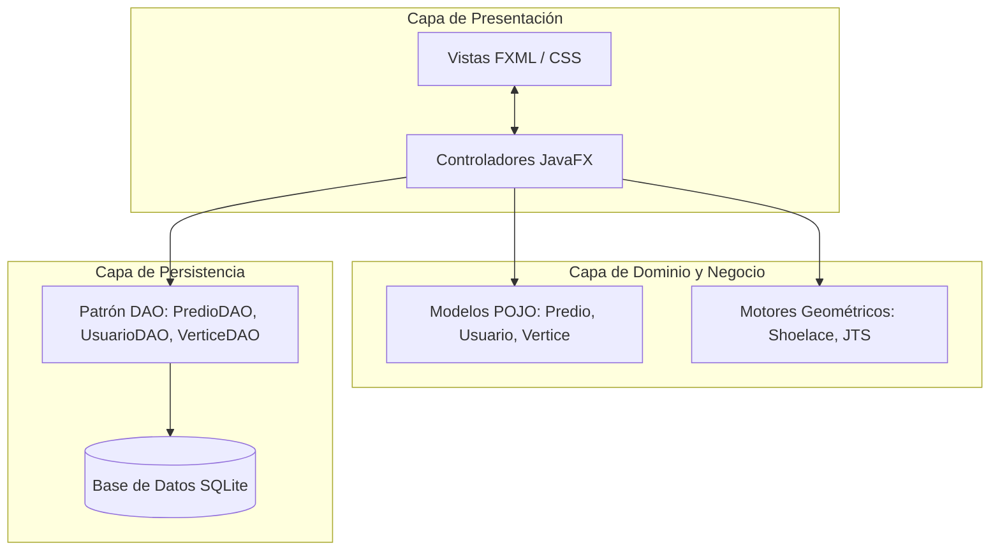

# 🎓 Guía y Banco de 10 Preguntas de Sustentación — Ingeniería de Software

**Proyecto:** SIGCAT (Sistema de Información Geográfica y Catastral de Sincelejo)  
**Institución:** Universidad Antonio José de Sucre (UNIAJS)  
**Asignatura:** Ingeniería de Software | **Docente:** Ing. Juan Manuel Palacio  
**Equipo:** Cristian Morales, Andrés Diaz, Leider Barreto, Aldo Ibañez, José Sánchez  

---

## 📌 Índice de Preguntas
1. [Metodología de Desarrollo y Gestión de Tareas (Kanban + GitHub Flow)](#pregunta-1)
2. [Gestión de Requisitos Funcionales (RF) y No Funcionales (RNF)](#pregunta-2)
3. [Arquitectura de Software y Patrones de Diseño Aplicados](#pregunta-3)
4. [Uso de Métricas de Software (Calidad, Proceso y Rendimiento)](#pregunta-4)
5. [Estrategia de Aseguramiento de Calidad y Pruebas Automatizadas (QA)](#pregunta-5)
6. [Gestión de Concurrencia, Transacciones ACID e Integridad de Datos](#pregunta-6)
7. [Aplicación de Principios de Diseño SOLID](#pregunta-7)
8. [Resolución de Deuda Técnica y Gestión de Defectos Reales](#pregunta-8)
9. [Seguridad del Software y Mitigación de Vulnerabilidades](#pregunta-9)
10. [Mantenibilidad, Escalabilidad y Plan de Evolución del Software](#pregunta-10)

---

### Pregunta 1: ¿Qué metodología de desarrollo de software utilizaron y cómo se organizaron en el equipo?

#### 🎯 Respuesta Formal:
Adoptamos una **metodología ágil e iterativa** fundamentada en el marco de trabajo **Kanban**, combinada con el flujo de ramificación y control de versiones **GitHub Flow**.

* **Flujo Continuo (Kanban):** El ciclo de vida de los requerimientos se modeló en un tablero con cuatro columnas operativas: *Backlog (Por Hacer)*, *En Desarrollo (In Progress)*, *Revisión y Pruebas (QA / Code Review)* y *Completado (Done)*. Aplicamos límites de trabajo en progreso (*WIP*) para evitar saturación entre fases.
* **Especialización por Roles:** Para cumplir con el principio de división de responsabilidades de la ingeniería de software, distribuimos los roles de acuerdo a las fortalezas del equipo:
  * *Arquitectura:* Cristian Morales (coordinación técnica, empaquetado y concurrencia).
  * *Lógica Core y Geometría:* Andrés Diaz (Shoelace, proyecciones métricas y JTS).
  * *Experiencia de Usuario (UI/UX):* Leider Barreto (vistas FXML, CSS y Canvas OSM).
  * *Persistencia de Datos:* Aldo Ibañez (esquema relacional, transacciones SQLite y DAOs).
  * *Calidad y Testing:* José Sánchez (automatización con JUnit 5 y matrices de prueba).
* **Trazabilidad y Control de Versiones:** Cada tarea se integró al repositorio Git mediante commits atómicos siguiendo el estándar *Conventional Commits* (`feat:`, `fix:`, `docs:`), lo que asegura trazabilidad histórica desde el requerimiento hasta el código de producción.

---

### Pregunta 2: ¿Cómo definieron y validaron los Requisitos Funcionales y No Funcionales?

#### 🎯 Respuesta Formal:
El sistema se construyó a partir de una matriz de trazabilidad de requisitos basada en el estándar IEEE 830:

* **Requisitos Funcionales (RF):**
  * **RF-01 (Georreferenciación WGS84):** Captura de vértices geográficos anclados a latitud y longitud reales sobre el mapa de Sincelejo.
  * **RF-02 (Cálculo Métrico):** Estimación de área en metros cuadrados ($m^2$) y perímetro en metros lineales ($m$) mediante proyección Gauss/Shoelace.
  * **RF-03 (Control de Integridad Topológica):** Detección y bloqueo automático de solapamientos contra la malla oficial de Sincelejo.
  * **RF-04 (Auditoría y Dictamen Motivado):** Aprobación o rechazo de solicitudes; en caso de rechazo, el sistema exige justificación técnica obligatoria.
  * **RF-05 (Gestión de Trámites):** Edición y retiro/eliminación de solicitudes tanto para propietarios como funcionarios.
* **Requisitos No Funcionales (RNF):**
  * **RNF-01 (Seguridad Criptográfica):** Protección de credenciales con factor de costo 12 mediante BCrypt y salting dinámico.
  * **RNF-02 (Tecnología Nativa):** Ejecución 100% Java puro de escritorio (Java 17 LTS + JavaFX 21), sin recurrir a tecnologías web, HTML ni navegadores embebidos.
  * **RNF-03 (Concurrencia Multi-PC):** Acceso simultáneo desde múltiples estaciones de trabajo mediante SQLite en modo WAL (*Write-Ahead Logging*).

---

### Pregunta 3: ¿Qué arquitectura y patrones de diseño aplicaron en el código?

#### 🎯 Respuesta Formal:
Se implementó una **arquitectura en capas desacoplada** gobernada por patrones de diseño reconocidos:

1. **MVC (Modelo - Vista - Controlador):** Separación estricta entre la interfaz declarativa (`FXML`), los controladores que atienden eventos (`MenuFuncionarioController`, `DibujoController`) y los modelos de datos (`Predio`, `Usuario`).
2. **DAO (Data Access Object):** Aísla por completo las sentencias SQL y la tecnología de base de datos de la lógica de negocio. Esto permite cambiar el motor de persistencia sin alterar una sola línea de la interfaz gráfica.
3. **Singleton:** Utilizado en `DatabaseConnection.java` para mantener un único punto de acceso controlado a la conexión de base de datos, optimizando recursos y evitando bloqueos de archivos.
4. **DTO (Data Transfer Object):** Implementado en `SolicitudRow` para transferir y proyectar eficientemente los datos tabulares requeridos por el funcionario.
5. **Adapter:** En `VerticeAdapter`, adaptando las coordenadas de nuestro modelo de dominio hacia las estructuras que requiere la librería JTS.

---

### Pregunta 4: ¿Qué métricas de software utilizaron para evaluar el proyecto?

#### 🎯 Respuesta Formal:
Gestionamos tres tipos de métricas de ingeniería de software:

| Categoría | Métrica | Valor Medido | Justificación Técnica |
| --------- | ------- | ------------ | --------------------- |
| **Calidad de Pruebas** | *Test Pass Rate* | **100% (26/26 pruebas)** | Cobertura de caminos críticos en lógica geométrica, seguridad y persistencia. |
| **Densidad de Defectos** | *Defect Leakage* | **0 regresiones** | Los defectos detectados se cubrieron con tests unitarios específicos para blindar el código. |
| **Complejidad Algorítmica** | Cálculo de Shoelace | $\mathcal{O}(N)$ | Donde $N$ es el número de vértices; el área se obtiene en $< 1 \text{ ms}$. |
| **Complejidad Algorítmica** | Detección de Solapamiento | $\mathcal{O}(1)$ filtro preliminar | Fase 1 con *Axis-Aligned Bounding Box (AABB)* en $\mathcal{O}(1)$; Fase 2 (JTS Ray-Casting) solo si hay colisión de cajas. |
| **Seguridad** | *Work Factor BCrypt* | **12 ($2^{12}$ rondas)** | Tiempo de respuesta intencional de $\approx 250 \text{ ms}$ para neutralizar ataques de fuerza bruta. |
| **Rendimiento UI** | Latencia de Cartografía | $< 100 \text{ ms}$ | Renderizado asíncrono con multihilos y caché en memoria para teselas OpenStreetMap. |
| **Concurrencia** | *Lock Timeout* | **5000 ms** | Tiempo máximo de espera activa ante escrituras simultáneas en red local. |

---

### Pregunta 5: ¿Cuál fue su estrategia de pruebas y aseguramiento de calidad (QA)?

#### 🎯 Respuesta Formal:
Implementamos una estrategia de pruebas multinivel basada en la **Pirámide de Pruebas**, automatizada con **JUnit 5**:

* **Pruebas Unitarias Aisladas:** Verificación de funciones puras independientes de la base de datos o interfaz:
  * `ShoelaceCalculatorTest`: Precisión métrica de áreas, perímetros y centroides.
  * `SolapamientoValidatorTest`: Detección de invasión y separación de polígonos.
* **Pruebas de Persistencia con Base de Datos Aislada:**
  * Configuramos `maven-surefire-plugin` con el parámetro JVM `-Dsigcat.db=target/sigcat_test.db`.
  * Esto asegura que las 26 pruebas se ejecuten sobre una base de datos efímera de prueba, garantizando **cero contaminación de la base de datos de producción (`sigcat.db`)**.
* **Pruebas de Integración:**
  * `FlujoAprobacionIntegrationTest`: Simula el ciclo completo: radicación por un propietario $\rightarrow$ almacenamiento con vértices $\rightarrow$ detección topológica $\rightarrow$ dictamen del funcionario.
* **Estructura AAA:** Todas las pruebas siguen la convención formal **Arrange - Act - Assert**.

---

### Pregunta 6: ¿Cómo gestionaron la concurrencia y la integridad de las transacciones (ACID)?

#### 🎯 Respuesta Formal:
La integridad de los datos catastrales se garantizó mediante dos mecanismos:

1. **Transacciones Atómicas (ACID):**
   * En operaciones complejas, como la inserción de un predio junto con sus $N$ vértices o la eliminación de una solicitud, desactivamos la confirmación automática (`conn.setAutoCommit(false)`).
   * Si todos los registros se insertan exitosamente, se ejecuta `conn.commit()`. Si algún vértice falla, se dispara un `conn.rollback()`, evitando estados inconsistentes o predios huérfanos sin geometría.
2. **Concurrencia Multi-Terminal con SQLite WAL:**
   * Configuramos `PRAGMA journal_mode = WAL` (*Write-Ahead Logging*). A diferencia del modo tradicional que bloquea toda la base de datos al escribir, el modo WAL permite que **múltiples terminales lean concurrentemente sin bloquearse**, mientras un proceso escribe en el registro WAL.
   * Agregamos `PRAGMA busy_timeout = 5000` para que, ante escrituras simultáneas, la conexión espere hasta 5 segundos antes de arrojar un error de contención.

---

### Pregunta 7: ¿Qué principios SOLID se evidencian en el código?

#### 🎯 Respuesta Formal:
* **S — Single Responsibility Principle (Principio de Responsabilidad Única):**
  * `ShoelaceCalculator`: Única responsabilidad de resolver cálculos geométricos.
  * `PasswordUtil`: Única responsabilidad de hashing y verificación criptográfica.
  * `PredioDAO`: Única responsabilidad del acceso a datos de predios.
* **O — Open/Closed Principle (Principio de Abierto/Cerrado):**
  * La arquitectura del motor cartográfico y validación topológica permite incorporar nuevas reglas normativas (por ejemplo, restricciones de retiros viales o zonas de riesgo) sin modificar el controlador de dibujo ni la vista FXML.
* **D — Dependency Inversion Principle (Principio de Inversión de Dependencias):**
  * Los controladores de JavaFX no dependen de detalles de bajo nivel ni manipulan conexiones JDBC directamente; interactúan a través de las abstracciones y métodos de los DAOs y modelos de dominio.

---

### Pregunta 8: ¿Qué defectos o deuda técnica real encontraron y cómo los resolvieron?

#### 🎯 Respuesta Formal:
Durante el proceso de desarrollo e inspección identificamos dos casos críticos de deuda técnica y lógica que fueron resueltos mediante ingeniería:

* **Caso 1: Conflicto de Solapamiento en Aprobaciones Concurrentes:**
  * *Defecto:* Si dos propietarios radicaban sobre el mismo lote físico mientras el predio no estaba aprobado, el funcionario podía cometer el error de aprobar ambos, generando una colisión en el catastro oficial.
  * *Solución:* Implementamos una validación topológica estricta previa a la aprobación que compara el lote contra la malla oficial de Sincelejo bloqueando la acción si hay invasión. Adicionalmente, al aprobarse un lote, el sistema identifica y **rechaza automáticamente con dictamen motivado** cualquier otra solicitud pendiente que quede solapada.
* **Caso 2: Inconsistencia Léxica en Filtros de Bandeja:**
  * *Defecto:* Al seleccionar `"TODAS LAS SOLICITUDES"`, la tabla aparecía vacía porque el DAO verificaba `startsWith("TODO")`, ignorando la palabra femenina `"TODA"`.
  * *Solución:* Se refactorizó la condición en `PredioDAO.java` para reconocer comodines generales (`TODA`, `TODO`, `ALL`) y se añadió una prueba unitaria formal en `PredioDAOTest` para evitar regresiones.

---

### Pregunta 9: ¿Cómo abordaron la seguridad del software y la mitigación de vulnerabilidades?

#### 🎯 Respuesta Formal:
La seguridad fue tratada como un requisito no funcional de primer nivel:

1. **Prevención de Inyección SQL (CWE-89):**
   * El 100% de las consultas a la base de datos se ejecutan a través de `PreparedStatement` parametrizados. Ningún valor ingresado por el usuario se concatena directamente en sentencias SQL.
2. **Protección de Credenciales (RNF-01 / OWASP Top 10):**
   * Las contraseñas nunca se almacenan en texto plano. Se implementó **BCrypt** con factor de trabajo 12 y salting aleatorio criptográficamente seguro, haciendo inviables los ataques por tablas arcoíris (*rainbow tables*).
3. **Control de Acceso Basado en Roles (RBAC):**
   * Separación estricta de privilegios: un usuario con rol `PROPIETARIO` no tiene acceso a las pantallas ni métodos de dictamen del `FUNCIONARIO`.
4. **Validación Defensiva en Capa de Datos:**
   * La base de datos cuenta con restricciones `CHECK(rol IN ('PROPIETARIO', 'FUNCIONARIO'))` y claves foráneas para impedir inserciones de usuarios con roles inválidos.

---

### Pregunta 10: ¿Cómo garantiza el diseño que el software sea mantenible y escalable a futuro?

#### 🎯 Respuesta Formal:
* **Bajo Acoplamiento y Alta Cohesión:** Gracias al patrón DAO y la arquitectura en capas, si la universidad o la alcaldía deciden migrar la base de datos de SQLite local a una nube distribuida (como PostgreSQL o Supabase), **solo se debe actualizar la clase de conexión y las sentencias del DAO**, manteniendo el 100% de los controladores JavaFX, vistas FXML y motores geométricos intactos.
* **Empaquetado Autónomo (Fat JAR con Maven Shade):** El proyecto se distribuye como un artefacto ejecutable autocontenido (`SIGCAT-1.0-SNAPSHOT-fat.jar`) que incluye JavaFX y todas las librerías necesarias, eliminando problemas de configuración de entorno (*"en mi máquina sí funciona"*).
* **Documentación Viva:** El repositorio cuenta con especificaciones de casos de prueba, manuales técnicos de sustentación y un `README.md` actualizado con instrucciones reproducibles de compilación y despliegue.

---

> 💡 **Consejo para la Sustentación:**  
> Cuando el profesor pregunte algo, comiencen siempre mencionando el **concepto formal** (ej. *"Usamos Kanban y GitHub Flow..."*, *"Aplicamos el patrón DAO y transacciones ACID..."*) y luego muestren el **ejemplo concreto en el código** (ej. *"...como se puede observar en `PredioDAO.java` y `MenuFuncionarioController.java`"*). Eso demuestra dominio teórico y práctico total.