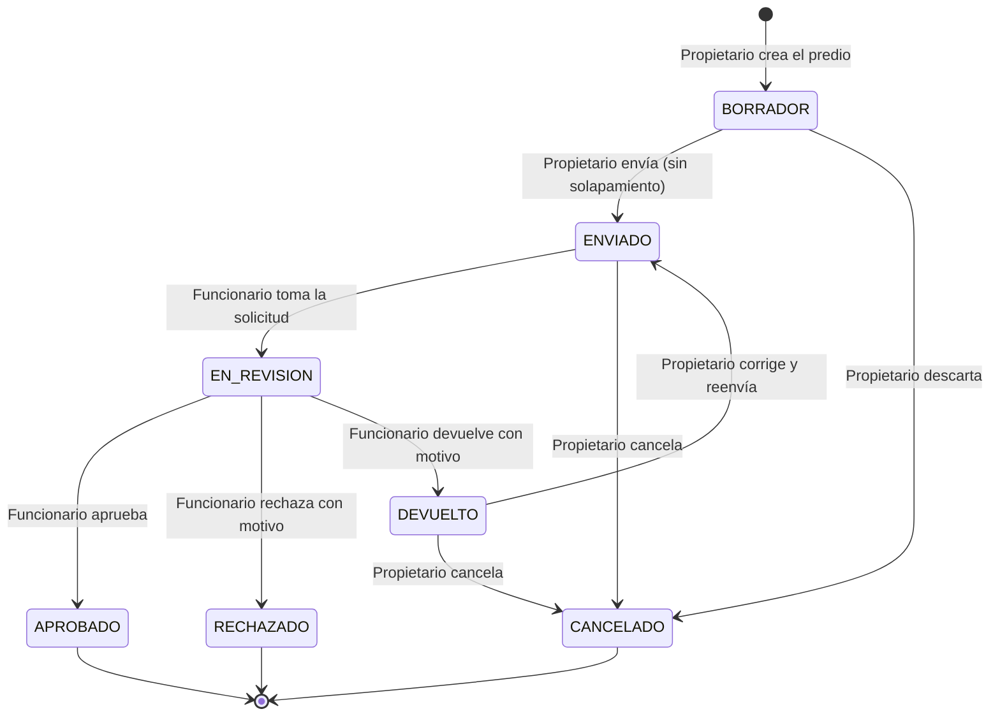
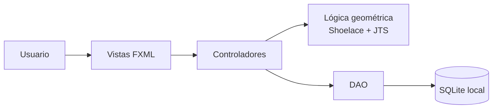
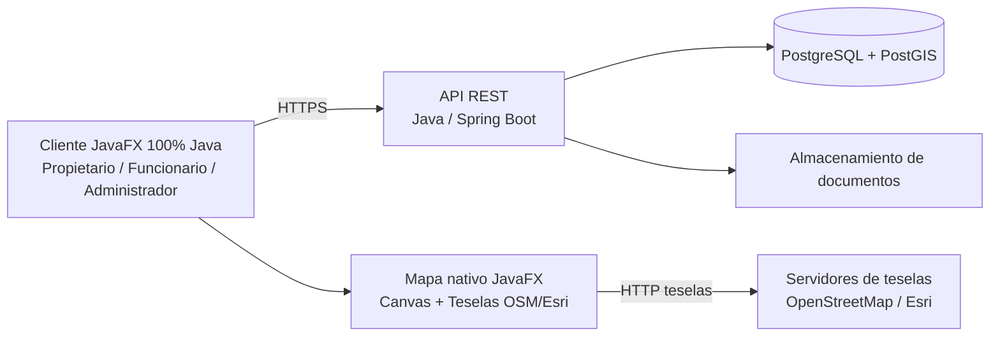
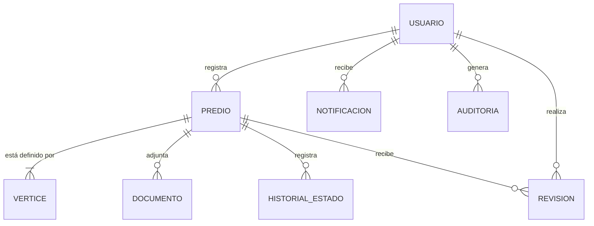

# 🗺️ SIGCAT — Sistema de Registro Gráfico de Predios y Detección Automática de Solapamiento Catastral

**Institución:** Universidad Antonio José de Sucre (UNIAJS)
**Programa:** Ingeniería de Sistemas | **Asignatura:** Ingeniería de Software
**Docente:** Ing. Juan Manuel Palacio

> **Leyenda de estado usada en este documento:**
> ✅ Completado · 🔄 En curso · 📋 Planificado · ⚠️ Pendiente de decisión del equipo · 🆕 Nuevo respecto a la versión anterior del README

---

## 📑 Tabla de contenido

1. [Visión y objetivo](#-1-visión-y-objetivo)
2. [Estado actual del proyecto](#-2-estado-actual-del-proyecto)
3. [Equipo y roles](#-3-equipo-y-roles)
4. [Alcance](#-4-alcance)
5. [Actores del sistema](#-5-actores-del-sistema)
6. [Requisitos](#-6-requisitos)
7. [Proceso de negocio: ciclo de vida del predio](#-7-proceso-de-negocio-ciclo-de-vida-del-predio)
8. [Arquitectura](#️-8-arquitectura)
9. [Módulo de mapa interactivo](#-9-módulo-de-mapa-interactivo)
10. [Modelo de datos](#️-10-modelo-de-datos)
11. [Estructura del proyecto](#-11-estructura-del-proyecto)
12. [Hoja de ruta](#-12-hoja-de-ruta)
13. [Puntos de integración entre miembros](#-13-puntos-de-integración-entre-miembros)
14. [Gestión de riesgos](#️-14-gestión-de-riesgos)
15. [Deuda técnica conocida](#-15-deuda-técnica-conocida)
16. [Definition of Done y flujo de trabajo](#-16-definition-of-done-y-flujo-de-trabajo)
17. [Guía de diseño](#-17-guía-de-diseño)
18. [Cómo ejecutar el proyecto](#-18-cómo-ejecutar-el-proyecto)
19. [Tareas pendientes por miembro](#-19-tareas-pendientes-por-miembro)
20. [Documentación del proyecto](#-20-documentación-del-proyecto)
21. [Glosario](#-21-glosario)

---

## 🎯 1. Visión y objetivo

SIGCAT nació como un prototipo académico para agilizar el registro catastral y reducir los conflictos de linderos mediante el dibujo de predios y la detección automática de solapamientos.

**La nueva meta del equipo es evolucionarlo de prototipo a un producto de software profesional**, apto para ser probado en un **piloto con usuarios reales**, aplicando de forma integral lo aprendido en la carrera: análisis de requisitos, diseño de software, bases de datos, redes, seguridad, calidad y despliegue.

Para lograrlo, el proyecto pasa de ser "un lienzo que dibuja polígonos" a ser un sistema completo con:

- **Cuentas de usuario** con registro, autenticación segura y tres roles (Propietario, Funcionario, Administrador).
- **Mapa real interactivo** (calles y satélite) centrado en Sincelejo y alrededores, para marcar el terreno sobre su ubicación geográfica verdadera.
- **Flujo completo de gestión**: borrador → envío → revisión → aprobación, rechazo o devolución con motivo.
- **Paneles propios** para cada rol, con las opciones que cualquier cliente espera de un software formal.
- **Base de datos central**, trazabilidad (auditoría) y notificaciones.

> ⚖️ **Nota de alcance legal:** SIGCAT es un sistema académico y de piloto. **No sustituye** los procesos catastrales oficiales, que corresponden a entidades como el IGAC o los catastros descentralizados. El piloto se plantea con datos de prueba o con una entidad que acepte evaluarlo explícitamente.

> ☕ **Restricción técnica innegociable — 100% Java puro:** El desarrollo del software es **estrictamente 100% Java (Java 17 LTS y JavaFX 21)**. Se prohíbe el uso de tecnologías web (HTML, JavaScript, CSS web o navegadores embebidos como WebView). Todos los módulos (mapa interactivo con teselas, proyección de coordenadas, motor geométrico, base de datos y GUI) se implementan con componentes nativos de Java y JavaFX.

---

## 📊 2. Estado actual del proyecto

El proyecto se organiza en dos hitos:

| Hito | Descripción | Estado |
| ---- | ----------- | ------ |
| **Hito 1 — Prototipo académico** | Login, Canvas con coordenadas relativas, Shoelace, JTS, DAO con SQLite, panel básico de funcionario, validación asíncrona, Fat JAR y pruebas unitarias/E2E | ✅ Completado |
| **Hito 2 — SIGCAT 2.0 (producto piloto)** 🆕 | Análisis y diseño formal, base de datos central, registro, mapa real, paneles completos, auditoría, despliegue y piloto | 📋 Planificado |

### Resumen de funcionalidades

| Funcionalidad | Estado |
| ------------- | ------ |
| Login con navegación por rol (Propietario / Funcionario) | ✅ |
| Canvas interactivo para dibujar polígonos (coordenadas relativas) | ✅ |
| Cierre automático del polígono al hacer clic cerca del primer vértice | ✅ |
| Cálculo de área con Algoritmo de Shoelace | ✅ |
| Detección de solapamiento con JTS Topology Suite | ✅ |
| Persistencia con DAO sobre SQLite (usuarios, predios, vértices) | ✅ |
| Panel básico del funcionario (`TableView` de pendientes, aprobar/rechazar) | ✅ |
| Conexión de la persistencia al flujo de dibujo (guardar predio PENDIENTE) | ✅ Conectado en `DibujoController` |
| Alimentar el Canvas con predios aprobados desde la BD | ✅ Conectado en `MenuPropietarioController` |
| Fat JAR ejecutable | ✅ Configurado y empaquetado (`SIGCAT-1.0-SNAPSHOT-fat.jar`) |
| Pruebas automatizadas (Unitarias y E2E con JUnit 5) | ✅ 20 pruebas operativas y pasando al 100% |
| Validación en segundo plano (no congela la interfaz) | ✅ Implementado con `Task<ResultadoRegistro>` e hilo daemon |
| Seguridad: Hash de contraseñas con BCrypt (RNF-01) | ✅ Implementado con factor de costo 12 y migración transparente |
| Registro de usuarios 🆕 | 📋 |
| Mapa real con calles y satélite 🆕 | 📋 |
| Menús completos de Propietario 🆕 | 📋 |
| Panel de administración del Funcionario 🆕 | 📋 |
| Rol de Administrador 🆕 | 📋 |
| Base de datos central y backend 🆕 | ⚠️ Pendiente de decisión (ver ADR-002) |
| Auditoría, notificaciones y reportes 🆕 | 📋 |

> ℹ️ **El Hito 1 (Prototipo académico) se encuentra 100% completado y probado.** Las tareas planificadas corresponden a la evolución del Hito 2.

---

## 👥 3. Equipo y roles

| Miembro | Rol | Responsabilidades clave |
| ------- | --- | ----------------------- |
| **Cristian Morales** | Técnico y Arquitecto | Arquitectura, integración de módulos, configuración de Maven (`pom.xml`), empaquetado final, decisiones técnicas (ADR) y coordinación del despliegue |
| **Andrés Diaz** | Desarrollador Core | Lógica espacial, algoritmo de Shoelace, motor de validación con JTS, reglas geométricas y panel del funcionario |
| **Leider Barreto** | Desarrollador UI/UX | Vistas JavaFX (FXML), interacción de dibujo, feedback visual, integración del mapa, prototipos y guía de diseño |
| **Aldo Ibañez** | Desarrollador de Persistencia | Esquema de base de datos, patrón DAO, migraciones y gestión de datos de predios y vértices |
| **José Sánchez** | Analista de Calidad (QA) | Casos de prueba, pruebas unitarias con JUnit, pruebas end-to-end y documentación del flujo de aprobación |

> 🆕 En el Hito 2 se propone un reparto por **frentes de trabajo** (sección 12). Es una propuesta que el equipo debe validar en reunión.

---

## 🔭 4. Alcance

### ✅ Incluido en el Hito 1 (prototipo)

- **Autenticación:** acceso basado en roles (Propietario y Funcionario).
- **Captura gráfica:** lienzo (Canvas) interactivo para el registro de perímetros.
- **Cálculo automático:** superficie mediante el Algoritmo de Shoelace.
- **Detección de conflictos:** validación preventiva de solapamientos con **JTS Topology Suite**.
- **Flujo de gestión básico:** solicitud → revisión → aprobación o rechazo por el funcionario.

### 🆕 Incluido en el Hito 2 (producto piloto)

- **Registro de usuarios** y gestión de cuenta (perfil, recuperación de contraseña).
- **Tres roles:** Propietario, Funcionario y **Administrador**.
- **Mapa real interactivo** con capas de calles y satélite, centrado en Sincelejo y alrededores, con búsqueda de lugares, medición y edición de vértices.
- **Datos catastrales ampliados** del predio (matrícula, número predial, ubicación, uso, etc.) y **documentos adjuntos**.
- **Ciclo de vida completo del predio**, incluyendo borrador y "devuelto para corrección".
- **Panel de administración del Funcionario:** indicadores, bandeja con filtros, revisión con contexto de vecinos, decisiones con motivo, comentarios, mapa general y reportes.
- **Auditoría** de acciones, **notificaciones** y **reportes exportables**.
- **Base de datos central** y despliegue para un piloto.

### ❌ Fuera de alcance (por ahora)

- Integración con servicios oficiales del IGAC o de catastros (consulta de predios oficiales, firma electrónica, pagos).
- Validez jurídica de las aprobaciones: el sistema es de apoyo y piloto.
- Polígonos complejos (con huecos internos, "islas" o curvas). Se evaluará en una versión posterior.
- Aplicación móvil nativa.

> ⚠️ **Cambio de alcance respecto a la versión anterior:** el README original excluía "mapas satelitales reales", "despliegue en red o nube" y "base de datos local embebida". El Hito 2 revierte esas exclusiones. **Debe comunicarse y acordarse con el docente.**

---

## 🧑‍🤝‍🧑 5. Actores del sistema

| Actor | Descripción | Capacidades principales |
| ----- | ----------- | ----------------------- |
| **Propietario** | Ciudadano que registra y gestiona sus predios | Registrarse, dibujar y enviar predios, adjuntar documentos, corregir solicitudes devueltas, consultar historial y notificaciones |
| **Funcionario** | Personal que revisa las solicitudes | Revisar solicitudes, aprobar / rechazar / devolver con motivo, comentar, ver mapa general, generar reportes |
| **Administrador** 🆕 | Responsable de la plataforma | Crear y gestionar funcionarios y roles, consultar auditoría, configurar parámetros, gestionar respaldos |

---

## 📋 6. Requisitos

> Esta sección es un **borrador de trabajo**. La versión formal se documentará en el SRS (sección 20), con criterios de aceptación por requisito.

### 6.1 Requisitos funcionales

**Cuentas y acceso**

| ID | Requisito |
| -- | --------- |
| RF-01 | El sistema permitirá el **registro** de propietarios con documento, nombre, correo, teléfono y contraseña, con validaciones de formato y unicidad. |
| RF-02 | El sistema permitirá iniciar sesión y redirigirá al menú correspondiente según el rol. |
| RF-03 | El sistema permitirá recuperar la contraseña. |
| RF-04 | El usuario podrá consultar y editar su perfil. |
| RF-05 | El registro exigirá la aceptación del tratamiento de datos personales. |

**Propietario**

| ID | Requisito |
| -- | --------- |
| RF-10 | Panel de inicio con resumen de sus predios por estado. |
| RF-11 | Listado "Mis predios" con filtros, detalle e historial de cada solicitud. |
| RF-12 | Registro de predio mediante formulario de datos catastrales y dibujo sobre el mapa. |
| RF-13 | Guardado de **borradores** antes del envío. |
| RF-14 | Adjuntar documentos de soporte (escritura, certificado de tradición, otros). |
| RF-15 | Corrección y reenvío de solicitudes **devueltas**. |
| RF-16 | Cancelación de solicitudes en curso. |
| RF-17 | Consulta de notificaciones sobre cambios de estado. |

**Funcionario**

| ID | Requisito |
| -- | --------- |
| RF-20 | Panel con indicadores (pendientes, resueltas, tiempo promedio de respuesta). |
| RF-21 | Bandeja de solicitudes con búsqueda, filtros y ordenamiento. |
| RF-22 | Vista de revisión con datos, documentos, mapa con predios vecinos y resultado de las validaciones automáticas. |
| RF-23 | Acciones de **aprobar, rechazar o devolver**, con **motivo obligatorio** en rechazo y devolución. |
| RF-24 | Comentarios internos sobre cada solicitud. |
| RF-25 | Mapa general de predios aprobados. |
| RF-26 | Reportes exportables (PDF, CSV, GeoJSON). |

**Administrador**

| ID | Requisito |
| -- | --------- |
| RF-30 | Gestión de usuarios y roles (alta, baja, activación, asignación de rol). |
| RF-31 | Consulta del registro de auditoría. |
| RF-32 | Configuración de parámetros del sistema. |
| RF-33 | Gestión de respaldos de la base de datos. |

**Mapa y geometría**

| ID | Requisito |
| -- | --------- |
| RF-40 | Mapa base con capas de **calles y satélite**, centrado inicialmente en Sincelejo. |
| RF-41 | Dibujo interactivo del predio, con **edición de vértices** arrastrables. |
| RF-42 | Búsqueda de lugares (municipios, veredas, direcciones). |
| RF-43 | Visualización de predios aprobados como contexto, sin interferir con el dibujo. |
| RF-44 | Cálculo automático de **área (m² y hectáreas)** y perímetro. |
| RF-45 | Detección automática de **solapamiento** con predios aprobados y aviso visual inmediato. |

### 6.2 Requisitos no funcionales

| ID | Categoría | Requisito |
| -- | --------- | --------- |
| RNF-01 | Seguridad | Contraseñas almacenadas con **hash seguro (BCrypt)**; nunca en texto plano. |
| RNF-02 | Seguridad | La autorización por rol se valida en la **capa de servicio/servidor**, no solo ocultando botones en la interfaz. |
| RNF-03 | Seguridad | Todas las consultas a la base de datos usan sentencias **parametrizadas**. |
| RNF-04 | Privacidad | Tratamiento de datos personales conforme a la **Ley 1581 de 2012** (Colombia). |
| RNF-05 | Rendimiento | La validación de solapamiento **no debe bloquear la interfaz**. Las metas de tiempo se definirán en el SRS. |
| RNF-06 | Trazabilidad | Toda acción relevante (decisiones, cambios de estado, gestión de usuarios) queda registrada en auditoría. |
| RNF-07 | Usabilidad | Mensajes claros, confirmaciones en acciones destructivas y flujos coherentes entre roles. |
| RNF-08 | Portabilidad | Compila y ejecuta en **Java 17 LTS**; sin rutas ni credenciales *hardcoded*. |
| RNF-09 | Mantenibilidad | Arquitectura por capas, esquema de base de datos con **migraciones versionadas** y código con pruebas automatizadas. |
| RNF-10 | Disponibilidad | Respaldos periódicos de la base de datos. Meta de disponibilidad a definir para el piloto. |

---

## 🔄 7. Proceso de negocio: ciclo de vida del predio 🆕

Una solicitud de predio atraviesa los siguientes estados. Hoy el prototipo solo maneja `PENDIENTE`, `APROBADO` y `RECHAZADO`; el modelo ampliado añade borrador, revisión, devolución y cancelación.



**Reglas del proceso:**

- Solo los predios en estado `APROBADO` participan como referencia en la detección de solapamiento.
- Rechazo y devolución exigen un **motivo** registrado.
- Cada cambio de estado queda en el **historial** y en la **auditoría**.
- ⚠️ *Por definir con el docente:* si los predios **colindantes** (que comparten lindero sin invadirse) se consideran conflicto. Propuesta: no lo son; solo se marca solapamiento cuando la intersección tiene área, con una tolerancia mínima.

---

## 🏛️ 8. Arquitectura

### 8.1 Arquitectura actual (Hito 1)

Aplicación de escritorio **JavaFX 21** con patrón **MVC**, base de datos **SQLite** embebida, geometría con **JTS 1.20** y Maven como gestor de proyecto.



**Limitación clave:** con SQLite local, cada computador tiene su propia base de datos. Para que propietarios y funcionarios compartan información real, hace falta una base de datos central.

### 8.2 Arquitectura objetivo propuesta (Hito 2) ⚠️



**Por qué esta arquitectura:**

- Una **base de datos central** permite que todos los roles trabajen con la misma información.
- Un **backend** evita exponer credenciales de la base de datos dentro del cliente y centraliza la seguridad y la autorización.
- **PostGIS** permite validar solapamientos dentro de la base de datos con índices espaciales, algo mucho más escalable que cargar todos los predios en memoria.

### 8.3 Registro de decisiones de arquitectura (ADR)

| ID | Decisión | Alternativas consideradas | Estado |
| -- | -------- | ------------------------- | ------ |
| ADR-001 | Mapa nativo en **JavaFX Canvas (100% Java)** cargando teselas de OpenStreetMap y Esri con proyección Web Mercator | WebView con Leaflet/JS (descartado por requisito de asignatura: 100% Java puro); Google Maps (descartado por costos y API key) | ✅ Aprobada (100% Java) |
| ADR-002 | **Backend + PostgreSQL/PostGIS** como base de datos central | Mantener SQLite local (no sirve para multiusuario real); escritorio conectado directo a una BD remota (inseguro: credenciales en el cliente) | ⚠️ Pendiente de decisión |
| ADR-003 | Guardar coordenadas en **WGS84 (lon/lat)** y calcular áreas tras proyectar a metros | Guardar en un sistema proyectado (p. ej. MAGNA-SIRGAS Origen Nacional, EPSG:9377), más exacto pero con más complejidad | 📋 Propuesta |
| ADR-004 | Mantener **JavaFX 21** como cliente exclusivo de escritorio para la entrega académica (100% Java) | Cliente web (descartado: la asignatura exige aplicación de escritorio en Java) | ✅ Aprobada |

> Cada ADR se documentará con contexto, decisión y consecuencias en `docs/adr/` cuando el equipo la ratifique.

---

## 🧭 9. Módulo de mapa interactivo (100% Java puro) 🆕

**Objetivo:** enriquecer el Canvas nativo de JavaFX para que descargue y renderice teselas (tiles) de mapas reales de calles y satélite, permitiendo al usuario dibujar sobre terreno georreferenciado real en Sincelejo, Sucre.

**Decisión técnica clave:** El mapa se construye **estrictamente en JavaFX nativo** (`Canvas`, `GraphicsContext`, `Image` y eventos de mouse), **sin HTML, sin JavaScript y sin WebView**.

**Capacidades previstas:**

- Capas conmutables de **calles** (OpenStreetMap) y **satélite** (Esri World Imagery) descargadas en segundo plano mediante `javafx.scene.image.Image`.
- Mapa centrado en **Sincelejo y alrededores** (Lat: 9.3047, Lon: -75.3978), con paneo (arrastrar con ratón) y zoom (rueda de desplazamiento).
- Proyección Web Mercator (EPSG:3857) implementada en Java puro (`GeoProjection.java`) para transformar bidireccionalmente entre coordenadas geográficas WGS84 (grados) y píxeles del Canvas.
- Dibujo del predio con clics directos sobre el Canvas, cierre al tocar el primer vértice y ajuste de vértices.
- Predios aprobados dibujados como contexto visual poligonal sobre el mapa base.
- Aviso visual inmediato: el polígono cambia de color si hay conflicto de solapamiento (detectado con JTS).
- Mapa general para el funcionario con visor de predios aprobados.

**Convenciones técnicas (contrato para todo el equipo):**

| Aspecto | Convención |
| ------- | ---------- |
| Implementación | 100% Java nativo en JavaFX (`Canvas`), sin HTML/JS ni WebView |
| Sistema de coordenadas almacenado | WGS84 (grados decimales) |
| Representación de un vértice en Java | `coord_x = longitud`, `coord_y = latitud` (en JTS, SQLite y `Point2D`) |
| Proyección en pantalla | Web Mercator EPSG:3857 calculada en `GeoProjection.java` |
| Cálculo de área | Convertir primero a **metros** (o cálculo geodésico esférico) y luego aplicar Shoelace; nunca calcular sobre grados |
| Esquema de BD | `coord_x` = longitud, `coord_y` = latitud |
| Formato numérico | Siempre con punto decimal (`Locale.US`), sin depender de la configuración regional |

**Consideraciones:**

- Requiere **conexión a internet** para descargar las imágenes de las teselas. Como contingencia para demos sin internet, el cargador de teselas en Java puede almacenar una caché local en disco (`.cache/tiles/`).
- Respetar las **atribuciones** de OpenStreetMap y Esri en la esquina inferior del Canvas.
- Los predios del prototipo inicial con coordenadas relativas de píxeles no son compatibles con el mapa real y deben recrearse sobre coordenadas WGS84.

---

## 🗄️ 10. Modelo de datos

### 10.1 Esquema actual (SQLite, Hito 1)

1. **Usuarios:** `id_usuario` (PK), `documento`, `nombre`, `password`, `rol` (PROPIETARIO, FUNCIONARIO).
2. **Predios:** `id_predio` (PK), `id_propietario` (FK), `id_funcionario` (FK), `area_calculada` (DOUBLE), `estado` (PENDIENTE, APROBADO, RECHAZADO), `fecha_registro`.
3. **Vertices:** `id_vertice` (PK), `id_predio` (FK), `orden` (INT), `coord_x` (DOUBLE), `coord_y` (DOUBLE).

### 10.2 Modelo ampliado propuesto 🆕



| Entidad | Propósito | Campos clave (propuestos) |
| ------- | --------- | ------------------------- |
| **USUARIO** | Cuentas de los tres roles | documento, nombre, correo, teléfono, hash de contraseña, rol, activo, fecha de alta |
| **PREDIO** | Solicitud/predio y datos catastrales | propietario, nombre del predio, matrícula inmobiliaria, número predial, municipio, vereda o dirección, uso, área, estado, fechas |
| **VERTICE** | Geometría del predio | predio, orden, longitud (`coord_x`), latitud (`coord_y`) |
| **DOCUMENTO** | Soportes adjuntos | predio, tipo, nombre, ubicación del archivo, fecha |
| **HISTORIAL_ESTADO** | Trazabilidad del ciclo de vida | predio, estado anterior, estado nuevo, usuario, fecha, motivo |
| **REVISION** | Decisiones y comentarios del funcionario | predio, funcionario, decisión, motivo, comentario, fecha |
| **NOTIFICACION** | Avisos al usuario | usuario, mensaje, leída, fecha |
| **AUDITORIA** | Registro de acciones relevantes | usuario, acción, entidad, detalle, fecha |

**Prácticas de datos:**

- **Migraciones versionadas** (p. ej. Flyway) para que todos los miembros y entornos tengan el mismo esquema.
- Datos semilla (usuarios de prueba) separados del esquema.
- Con PostGIS, la geometría del predio se almacenaría como tipo espacial con índice, además de (o en lugar de) los vértices ordenados.

---

## 📁 11. Estructura del proyecto

### 11.1 Estructura actual

```
src/
├── main/
│   ├── java/com/sigcat/
│   │   ├── app/
│   │   │   ├── App.java                      ← Punto de entrada JavaFX (Cristian)
│   │   │   └── MainLauncher.java             ← Launcher sin módulos para Fat JAR (Cristian)
│   │   ├── controllers/
│   │   │   ├── LoginController.java          ← Autenticación + navegación por rol ✅ (Leider)
│   │   │   ├── MenuPropietarioController.java← Menú propietario + carga de predios aprobados ✅ (Leider / Aldo)
│   │   │   ├── MenuFuncionarioController.java← Menú funcionario con tabla de pendientes ✅ (Leider / Andrés)
│   │   │   └── DibujoController.java         ← Canvas interactivo + validación asíncrona Task ✅ (Leider / Cristian / Aldo)
│   │   ├── geometry/
│   │   │   ├── ShoelaceCalculator.java       ← Área y perímetro oficial con Shoelace ✅ (Andrés)
│   │   │   ├── SolapamientoValidator.java    ← Validación de solapamiento con JTS ✅ (Andrés)
│   │   │   └── VerticeAdapter.java           ← Adaptador Point2D ↔ Vertice modelo ✅
│   │   ├── dao/
│   │   │   ├── UsuarioDAO.java               ← CRUD + autenticación SQLite ✅ (Aldo)
│   │   │   ├── PredioDAO.java                ← CRUD de predios y consultas por estado ✅ (Aldo)
│   │   │   └── VerticeDAO.java               ← Inserción y consulta de vértices ✅ (Aldo)
│   │   ├── models/
│   │   │   ├── Usuario.java                  ✅ (Aldo)
│   │   │   ├── Predio.java                   ✅ (Aldo)
│   │   │   └── Vertice.java                  ✅ (Aldo)
│   │   └── utils/
│   │       ├── DatabaseConnection.java       ✅ (Cristian)
│   │       └── DatabaseInitializer.java      ✅ (Cristian)
│   └── resources/
│       ├── fxml/
│       │   ├── login.fxml                    ✅ (Leider)
│       │   ├── menu-propietario.fxml         ✅ (Leider)
│       │   ├── menu-funcionario.fxml         ✅ (Leider / Andrés)
│       │   └── dibujo.fxml                   ✅ (Leider)
│       └── styles/
│           └── main.css                      ✅ (Leider)
└── test/
    └── java/com/sigcat/
        ├── geometry/
        │   ├── ShoelaceCalculatorTest.java   ← Pruebas unitarias de cálculo de área (4 tests) ✅ (José)
        │   └── SolapamientoValidatorTest.java← Pruebas unitarias de conflicto espacial JTS (3 tests) ✅ (José)
        ├── dao/
        │   ├── UsuarioDAOTest.java           ← Pruebas de autenticación y usuarios (5 tests) ✅ (José)
        │   └── PredioDAOTest.java            ← Pruebas de persistencia y estados (4 tests) ✅ (José)
        └── integration/
            └── FlujoAprobacionIntegrationTest.java ← Prueba E2E ciclo registro/aprobación (CP-24) ✅ (José)
```

### 11.2 Elementos nuevos previstos 🆕

La lista es **orientativa**; los nombres definitivos se acordarán durante el diseño.

```
src/main/java/com/sigcat/
    ├── geometry/                         ← Cálculos espaciales, Shoelace y proyección geográfica
    │   ├── GeoProjection.java            ← Proyección Web Mercator (EPSG:3857) WGS84 ↔ Píxeles Canvas
    │   └── GeodesicAreaCalculator.java   ← Cálculo de área real en m² y ha
    ├── map/                              ← Módulo de mapa nativo JavaFX (100% Java)
    │   ├── TileManager.java              ← Descarga y caché de teselas OSM/Esri con JavaFX Image
    │   └── MapaCanvas.java               ← Componente Canvas con paneo, zoom y dibujo sobre teselas
    ├── services/                         ← Lógica de negocio y reglas de autorización por rol
    ├── security/                         ← Hash de contraseñas con BCrypt (PasswordUtil ✅)
    └── controllers/                      ← Registro, paneles de propietario, funcionario y administrador

src/main/resources/
    └── fxml/                             ← Vistas FXML de login, dibujo, paneles y administración
```

Si se aprueba el backend (ADR-002), se añadirá un módulo/repositorio separado para la API y la capa DAO del cliente será reemplazada por un cliente de la API.

---

## 🛣️ 12. Hoja de ruta

### Hito 1 — Prototipo académico

#### Fase 1: Fundamentos y arquitectura base ✅ COMPLETADA

- ✅ Configuración de Maven con JavaFX 21, SQLite, JTS 1.20 y JUnit 5
- ✅ Script de inicialización SQLite (`DatabaseInitializer`)
- ✅ DAO de conexión (`DatabaseConnection`, `UsuarioDAO`)
- ✅ Pantalla de login con navegación real por rol
- ✅ Menú Propietario y Menú Funcionario

#### Fase 2: Módulo gráfico y geometría básica ✅ COMPLETADA

- ✅ Canvas interactivo con clic para añadir vértices
- ✅ Cierre automático del polígono al hacer clic cerca del primer punto
- ✅ Cálculo de área con Shoelace (versión oficial de Andrés entregada)

#### Fase 3: Lógica espacial y persistencia de vértices ✅ COMPLETADA

- ✅ Integración de JTS Topology Suite (`SolapamientoValidator`)
- ✅ Detección de intersección entre el polígono nuevo y los predios aprobados
- ✅ Alimentar `DibujoController.setPrediosAprobados(...)` con los polígonos de la BD (`MenuPropietarioController.irADibujar`) (Aldo)
- ✅ Guardar predio + vértices en estado PENDIENTE al cerrar el polígono sin conflictos (Aldo / Cristian)

#### Fase 4: Flujo de aprobación y entrega ✅ COMPLETADA

- ✅ Panel básico de solicitudes del funcionario (`TableView` de pendientes, aprobar/rechazar con actualización en BD) (Andrés)
- ✅ Fat JAR ejecutable empaquetado con Maven Shade Plugin (`SIGCAT-1.0-SNAPSHOT-fat.jar`) (Cristian)
- ✅ Validación de solapamiento y persistencia en segundo plano con `Task<ResultadoRegistro>` e hilo daemon (Cristian)
- ✅ Suite de pruebas automatizadas (17 pruebas unitarias y de integración E2E pasando con JUnit 5) (José)

> 🎉 **El Hito 1 (Prototipo académico) está 100% completado.** Todas las bases técnicas, geométricas y de persistencia están operativas. A partir de aquí, las fases se enfocan en la evolución hacia el Hito 2.

---

### Hito 2 — SIGCAT 2.0 (producto piloto) 🆕

Las etapas son secuenciales en lo esencial, pero el trabajo dentro de cada una se reparte en paralelo por frentes. Los responsables indicados son **propuestos**.

#### Etapa A: Análisis y diseño formal 📋

- **Objetivo:** documentar qué se va a construir y cómo, antes de seguir programando.
- **Entregables:**
  - Documento de requisitos (SRS) con criterios de aceptación.
  - Casos de uso e historias de usuario por rol.
  - Diagramas: estados del predio, secuencia de los flujos principales, clases y entidad-relación ampliado.
  - Prototipos de pantallas (Figma) revisados con un usuario real.
  - Vista de arquitectura (modelo C4) y ADR ratificados.
  - Plan de pruebas con trazabilidad requisito → caso de prueba.
- **Responsables propuestos:** Cristian (arquitectura y ADR), Aldo (modelo de datos), Leider (prototipos), Andrés (reglas geométricas), José (plan de pruebas).
- **Criterio de salida:** documentos revisados por todo el equipo y validados con el docente; decisiones ADR-002 y ADR-004 cerradas.

#### Etapa B: Núcleo del sistema 📋

- **Objetivo:** base técnica sólida sobre la que construir los módulos.
- **Entregables:** base de datos central con migraciones, **registro de usuarios**, login seguro con hash, rol de Administrador, capa de servicios con autorización por rol y (si se aprueba) esqueleto del backend.
- **Responsables propuestos:** Cristian y Aldo.
- **Criterio de salida:** un usuario puede registrarse, iniciar sesión y ver el menú de su rol, con datos guardados en la base central.

#### Etapa C: Módulo del Propietario y mapa 📋

- **Objetivo:** experiencia completa del propietario con el mapa real.
- **Entregables:** dashboard, "Mis predios", formulario de datos catastrales, **mapa interactivo nativo JavaFX integrado**, borradores, adjuntos, corrección y reenvío, cancelación, notificaciones y perfil.
- **Responsables propuestos:** Leider (UI y mapa), Andrés (conversión a metros, área y solapamiento), Aldo (persistencia).
- **Criterio de salida:** un propietario registra un predio sobre el mapa de Sincelejo, lo envía y puede seguir su estado.

#### Etapa D: Módulo del Funcionario 📋

- **Objetivo:** panel de administración de solicitudes de nivel profesional.
- **Entregables:** dashboard con indicadores, bandeja con filtros, revisión con mapa de vecinos, aprobar/rechazar/devolver con motivo, comentarios y mapa general.
- **Responsables propuestos:** Andrés y Leider.
- **Criterio de salida:** el funcionario resuelve el ciclo completo de una solicitud, incluida una devolución y un reenvío.

#### Etapa E: Administración, auditoría y reportes 📋

- **Objetivo:** control, trazabilidad y salida de información.
- **Entregables:** gestión de usuarios y roles, registro de auditoría consultable, parámetros, respaldos y reportes (PDF, CSV, GeoJSON).
- **Responsables propuestos:** Aldo y Cristian.
- **Criterio de salida:** toda acción relevante queda auditada y el administrador puede gestionar usuarios.

#### Etapa F: Calidad, despliegue y piloto 📋

- **Objetivo:** llevar el sistema a uso real controlado.
- **Entregables:** pruebas unitarias, de integración y end-to-end; integración continua (GitHub Actions); empaquetado y despliegue; manual de usuario; piloto con usuarios reales y registro de hallazgos.
- **Responsables propuestos:** José (calidad) y Cristian (despliegue).
- **Criterio de salida:** piloto ejecutado, defectos críticos corregidos y lecciones aprendidas documentadas.

---

## 🔌 13. Puntos de integración entre miembros

> Contratos de interfaz que deben respetarse para que los módulos se conecten sin conflictos.

| Punto de integración | Quién produce | Quién consume | Contrato |
| -------------------- | ------------- | ------------- | -------- |
| Punto de integración | Quién produce | Quién consume | Contrato |
| -------------------- | ------------- | ------------- | -------- |
| Predios aprobados → mapa/Canvas | **Aldo** | **Leider** (`DibujoController`) | ✅ Conectado en `MenuPropietarioController.irADibujar()` llamando `setPrediosAprobados(List<Polygon>)` antes de mostrar la pantalla de dibujo. |
| Guardar predio | **Leider** invoca | **Aldo** implementa | ✅ Implementado en `DibujoController` mediante `PredioDAO.insertarConVertices(predio)`. |
| Cálculo de área | **Andrés** | **Leider** (`DibujoController`) | ✅ Implementado vía `ShoelaceCalculator.calcularArea(...)` utilizando `VerticeAdapter` para adaptar `Point2D`. |
| Panel funcionario | **Andrés** | `menu-funcionario.fxml` | ✅ Operativo en `MenuFuncionarioController` con `TableView` y actualización de estado en `PredioDAO`. |
| Componente de mapa 🆕 | **Leider** | Controladores de propietario y funcionario | Componente nativo en JavaFX (`Canvas` + `TileManager`) con API Java limpia (limpiar, centrar, marcar conflicto, cargar predios aprobados, notificar polígono cerrado). 100% Java, sin JavaScript ni HTML. |
| Validación asíncrona (riesgo de UI) | **Cristian** | `DibujoController` | ✅ Implementado con `Task<ResultadoRegistro>` e hilo daemon (`sigcat-validador`) para no congelar la UI. |
| Acceso a datos 🆕 | **Aldo** | Servicios y controladores | Los controladores no acceden a la BD directamente; usan la capa de servicios. Facilita migrar de DAO local a API remota. |

---

## ⚠️ 14. Gestión de riesgos

| Riesgo | Nivel | Plan de mitigación | Responsable |
| ------ | ----- | ------------------ | ----------- |
| Bloqueo del hilo de UI al validar solapamientos | Alto | ✅ Resuelto: migrado a `Task<ResultadoRegistro>` con hilo daemon en `DibujoController` | ~~Cristian~~ |
| Curva de aprendizaje de JTS | Medio | ✅ Resuelto: `SolapamientoValidator` operativo con JTS | ~~Leider / Andrés~~ |
| Deformación del polígono al redimensionar ventana | Medio | ✅ Deja de aplicar al reemplazar el Canvas por el mapa responsive | ~~Andrés~~ |
| 🆕 **Alcance demasiado grande para el tiempo del semestre** | Alto | Priorizar por etapas; definir un **MVP del piloto** (registro, mapa, flujo de aprobación) y dejar lo demás como mejora; revisar avance en cada etapa | Cristian |
| 🆕 Decisión de arquitectura sin cerrar (ADR-002 / ADR-004) | Alto | Cerrarla en la Etapa A, antes de construir el núcleo | Cristian y equipo |
| 🆕 Datos personales de propietarios (Ley 1581 de 2012) | Alto | Aviso y consentimiento en el registro, mínimo de datos necesarios, acceso por rol y auditoría | Cristian y José |
| 🆕 Dependencia de internet y de servicios de mapas de terceros | Medio | Plan de contingencia para demos (caché local de teselas en disco en Java puro); respetar políticas de uso de los proveedores | Leider |
| 🆕 Errores por orden de coordenadas (lat/lon) o por unidades (grados vs. metros) | Medio | Contrato documentado (sección 9), utilidad geográfica única y pruebas unitarias específicas | Andrés y José |
| 🆕 Conflictos de integración entre cinco personas | Medio | Ramas por funcionalidad, Pull Requests con revisión, contratos de interfaz (sección 13) | Cristian |
| 🆕 Datos antiguos con coordenadas relativas | Bajo | Descartarlos o recrearlos al activar el mapa real | Aldo |

---

## 🧹 15. Deuda técnica conocida 🆕

| Ítem | Detalle | Acción propuesta / Estado |
| ---- | ------- | ------------------------- |
| Dos `ShoelaceCalculator` | Existían versiones en `geometry/` y `logic/` | ✅ Resuelto: consolidado en `com.sigcat.geometry.ShoelaceCalculator` y eliminado el paquete `logic/` |
| Validación en el hilo de UI | La validación de solapamiento se ejecutaba en el hilo de JavaFX | ✅ Resuelto: ejecutado en segundo plano con `Task<ResultadoRegistro>` e hilo daemon |
| Pruebas automatizadas | Casos de prueba de geometría y flujo | ✅ Resuelto: 20 pruebas con JUnit 5 implementadas y pasando al 100% |
| Almacenamiento de contraseñas | Anteriormente se almacenaban en texto plano en la BD | ✅ Resuelto: migrado a hash seguro BCrypt (factor de costo 12, RNF-01) con migración transparente |
| Estados del predio incompletos | Solo PENDIENTE / APROBADO / RECHAZADO | 📋 Ampliar con BORRADOR, DEVUELTO, EN_REVISION (Etapa A y C) |

---

## ✅ 16. Definition of Done y flujo de trabajo

Una tarea se considera finalizada solo si:

1. El código compila sin errores en **Java 17 LTS**.
2. La funcionalidad no afecta secciones previamente operativas (sin regresiones).
3. El código ha sido integrado en la rama `main` del repositorio.
4. No existen rutas de archivos o credenciales *hardcoded* (configuración portable).
5. 🆕 La lógica nueva cuenta con **pruebas unitarias** cuando aplica.
6. 🆕 El cambio fue **revisado por otro miembro** mediante Pull Request.
7. 🆕 La documentación afectada (README, diagramas, SRS) fue actualizada.

### Flujo de trabajo propuesto 🆕

- `main` siempre debe estar estable y ejecutable.
- Cada funcionalidad se desarrolla en una **rama propia** (por ejemplo, `feature/mapa-canvas`) y se integra mediante **Pull Request**.
- Los *issues* de GitHub describen cada tarea con criterios de aceptación y responsable.
- Mensajes de commit claros y descriptivos.
- Antes de integrar un cambio que toque un punto de integración (sección 13), avisar al otro miembro involucrado.

---

## 🎨 17. Guía de diseño

Definida por Leider Barreto en `src/main/resources/styles/main.css`:

| Token | Valor | Uso |
| ----- | ----- | --- |
| Fondo principal | `#1a1a2e` | Pantallas de login y menús |
| Fondo secundario | `#16213e` | Campos de texto, toolbar |
| Fondo profundo | `#0d0d1a` | Áreas de contenido oscuras |
| Acento / error | `#e94560` | Botón primario, alertas de solapamiento |
| Texto principal | `#ffffff` | Títulos y textos destacados |
| Texto secundario | `#a0a0c0` | Labels, subtítulos, información auxiliar |

**Principios de usabilidad 🆕:** navegación consistente entre roles, mensajes de error comprensibles, confirmación antes de acciones irreversibles, estados vacíos informativos ("aún no tienes predios registrados") y retroalimentación visual inmediata en el mapa (color distinto ante solapamiento).

---

## 🚀 18. Cómo ejecutar el proyecto

### Requisitos

- Java 17 LTS
- Maven 3.8+
- 🆕 Conexión a internet (necesaria para el mapa una vez integrado)

### Ejecutar en desarrollo

```
mvn javafx:run
```

### Compilar (sin ejecutar)

```
mvn compile
```

### Probar el flujo actual de dibujo

1. Ejecuta la app con `mvn javafx:run`.
2. Inicia sesión como **propietario** (documento registrado en la BD).
3. Haz clic en **"Registrar nuevo predio"**.
4. Haz clic en el área de dibujo para añadir vértices (mínimo 3).
5. Haz clic cerca del círculo naranja (primer vértice) para cerrar el polígono.
6. Verás el área calculada y el estado de solapamiento.

> 🆕 El mapa interactivo se renderiza directamente sobre el `Canvas` de JavaFX usando descarga de teselas en segundo plano con `Image` y la proyección Web Mercator en Java, sin requerir dependencias web externas.

---

## 📋 19. Tareas pendientes por miembro

### Andrés Diaz

- ✅ Entregar `ShoelaceCalculator.java` oficial.
- ✅ Implementar el panel del Funcionario (versión inicial con tabla y aprobación/rechazo).
- ✅ Consolidar los dos `ShoelaceCalculator` en uno solo (eliminando `logic/`).
- [ ] 🆕 Definir con el equipo las reglas geométricas: tolerancia, tratamiento de predios colindantes y proyección a metros.
- [ ] 🆕 Ampliar el panel del funcionario (Etapa D).

### Aldo Ibañez

- ✅ Alimentar `setPrediosAprobados(...)` antes de mostrar la pantalla de dibujo en `MenuPropietarioController.irADibujar()`.
- ✅ Implementar la persistencia del predio + vértices en estado PENDIENTE al cerrar el polígono sin conflictos.
- [ ] 🆕 Diseñar el modelo de datos ampliado y las migraciones (Etapa A y B).

### Cristian Morales

- ✅ Mover la validación de solapamiento a un `Task<ResultadoRegistro>` asíncrono con hilo daemon (sin bloquear JavaFX).
- ✅ Configurar el Fat JAR ejecutable con `maven-shade-plugin` y merge de servicios JDBC (`SIGCAT-1.0-SNAPSHOT-fat.jar`).
- [ ] 🆕 Redactar y cerrar los ADR (arquitectura, base de datos, cliente).
- [ ] 🆕 Cerrar y verificar dependencias del proyecto 100% Java.
- [ ] 🆕 Acordar el cambio de alcance con el docente.

### Leider Barreto

- ✅ Vistas FXML principales y estilo global `main.css`.
- ✅ Canvas interactivo y retroalimentación visual de dibujo.
- [ ] 🆕 Prototipos de pantallas (registro, dashboard de propietario, detalle de predio, panel de funcionario).
- [ ] 🆕 Componente de mapa interactivo nativo JavaFX (Canvas + TileManager) y su integración en `DibujoController`.
- [ ] 🆕 Menús y vistas faltantes del propietario.

### José Sánchez (QA)

- ✅ Casos de prueba para `SolapamientoValidator` (polígonos solapados, adyacentes, disjuntos en `SolapamientoValidatorTest`).
- ✅ Casos de prueba para `ShoelaceCalculator` (triángulos, cuadrados, orden aleatorio en `ShoelaceCalculatorTest`).
- ✅ Pruebas unitarias para `UsuarioDAO` y `PredioDAO` (`UsuarioDAOTest`, `PredioDAOTest`).
- ✅ Pruebas end-to-end del flujo completo: login → dibujo → persistencia → aprobación (`FlujoAprobacionIntegrationTest`).
- [ ] 🆕 Plan de pruebas con trazabilidad a los requisitos y casos de prueba de la conversión lon/lat → metros.

---

## 📚 20. Documentación del proyecto

| Documento | Ubicación | Estado |
| --------- | --------- | ------ |
| Plan de Dirección y Desarrollo de Software | Raíz del repositorio (PDF) | ✅ |
| README (este documento) | Raíz del repositorio | ✅ Actualizado |
| Especificación de requisitos (SRS) | `docs/` | 📋 |
| Casos de uso e historias de usuario | `docs/` | 📋 |
| Modelo de datos y diagramas (estados, secuencia, clases) | `docs/` | 📋 |
| Prototipos de pantallas | `docs/` (enlace a Figma) | 📋 |
| Registro de decisiones de arquitectura (ADR) | `docs/adr/` | 📋 |
| Plan de pruebas | `docs/` | 📋 |
| Manual de usuario | `docs/` | 📋 |

---

## 📖 21. Glosario

| Término | Definición |
| ------- | ---------- |
| **Predio** | Terreno cuyo perímetro se registra en el sistema. |
| **Vértice** | Punto que forma parte del perímetro de un predio. |
| **Solapamiento** | Superposición de dos predios, es decir, un conflicto de linderos. |
| **Colindancia** | Cuando dos predios comparten un lindero sin invadirse. |
| **Algoritmo de Shoelace** | Fórmula que calcula el área de un polígono a partir de las coordenadas de sus vértices. |
| **JTS Topology Suite** | Librería Java para operaciones geométricas (intersecciones, validez de polígonos). |
| **PostGIS** | Extensión espacial de PostgreSQL para almacenar y consultar geometrías. |
| **WGS84** | Sistema de coordenadas geográficas (longitud y latitud) usado por los mapas y el GPS. |
| **Tesela (Map Tile)** | Imagen cuadrada (generalmente 256x256 px) descargada y renderizada por JavaFX en el Canvas para conformar el mapa base. |
| **Web Mercator (EPSG:3857)** | Proyección matemática estándar implementada en Java para convertir coordenadas geográficas WGS84 a píxeles. |
| **ADR** | *Architecture Decision Record*: documento breve que registra una decisión de arquitectura y su razón. |
| **MVC** | Patrón que separa Modelo, Vista y Controlador. |
| **DAO** | *Data Access Object*: patrón para aislar el acceso a la base de datos. |
