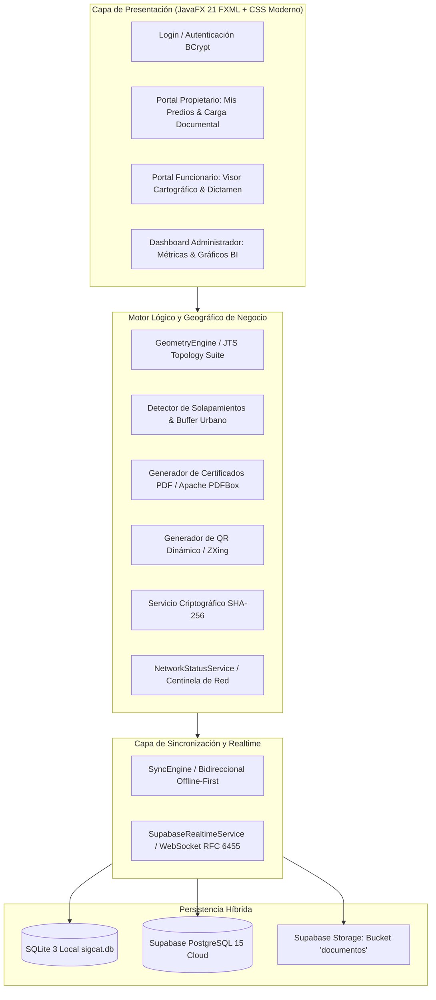

# 🗺️ SIGCAT v2.0 — Sistema de Información Geográfica y Catastral de Sincelejo

[](https://adoptium.net/temurin/releases/?version=17)
[](https://openjfx.io/)
[](https://supabase.com/)
[](https://www.sqlite.org/)
[](https://github.com/locationtech/jts)
[](https://pdfbox.apache.org/)
[](https://junit.org/junit5/)
[]()

> **Institución:** Corporación Universitaria Antonio José de Sucre (UNIAJS)  
> **Facultad:** Ciencias e Ingeniería | **Programa:** Ingeniería de Sistemas  
> **Asignatura:** Ingeniería de Software  
> **Docente Director:** Ing. Juan Manuel Palacio  
> **Área de Impacto Territorial:** Municipio de Sincelejo, Departamento de Sucre, Colombia (Código DANE: `70001`)

---

## 📌 1. Visión Ejecutiva y Problema Territorial

En el departamento de Sucre, los conflictos de límites de predios, la doble titulación y la invasión de bienes de uso público constituyen uno de los mayores desafíos legales y administrativos para los entes gubernamentales. Históricamente, la falta de cruces topológicos en tiempo real entre linderos privados y la malla catastral oficial genera disputas territoriales prolongadas.

**SIGCAT (Sistema de Información Geográfica y Catastral)** es una solución de escritorio nativa de nivel empresarial desarrollada en **Java 17 LTS** y **JavaFX 21**, diseñada para erradicar el solapamiento predial y garantizar la seguridad jurídica inmobiliaria en Sincelejo mediante:
1. **Validación Topológica Vectorial en Tiempo Real:** Empleo de la librería matemática **JTS (Java Topology Suite)** y algoritmos de aguja (Shoelace/Gauss) para detectar cualquier intersección espacial antes de radicar o aprobar un terreno.
2. **Protección de Bienes Inalienables:** Capa base precargada con los hitos institucionales de Sincelejo (Alcaldía, Gobernación, Parque Santander, Catedral San Francisco de Asís, CC Guacarí, CC Viva, Palacio de Justicia, etc.) protegidos contra invasión y titulación indebida.
3. **Certificación Catastral Criptográfica:** Emisión de certificados oficiales en formato PDF con firma digital SHA-256 y código QR dinámico verificado en la nube.
4. **Arquitectura Híbrida Offline-First:** Operación sin cortes en campo o desconexión mediante SQLite embebido y sincronización bidireccional automática con Supabase Cloud (PostgreSQL).

---

## 🏛️ 2. Arquitectura del Sistema

SIGCAT implementa una arquitectura desacoplada basada en capas (**Controller - Service - DAO - Model**), complementada con un motor de eventos asíncronos y un centinela de red.



---

## ⚡ 3. Diez Capacidades Corporativas Implementadas

| # | Capacidad | Módulo Técnico | Beneficio para Sincelejo |
|---|---|---|---|
| 1 | **Notificaciones Push en Tiempo Real** | `SupabaseRealtimeService` | Conexión WebSocket RFC 6455 nativa con Java 17; alerta a funcionarios y propietarios al instante cuando un predio cambia de estado sin requerir sondeo (polling). |
| 2 | **Firma Digital de Documentos** | `HashUtil` (SHA-256) | Genera una huella criptográfica inmutable de escrituras y certificados; previene la falsificación documental o sustitución de folios. |
| 3 | **Certificado de Incorporación Catastral en PDF** | `CertificadoCatastralService` | Maquetación con Apache PDFBox 3.0 con membrete oficial del Municipio de Sincelejo, tabla de linderos WGS84, sellos de aprobación y área calculada. |
| 4 | **Código QR de Verificación Ciudadana** | `QRCodeGenerator` (ZXing) | Incorporado en cada PDF; permite a la ciudadanía o notarías escanear el documento y verificar su validez directa en la nube de Supabase. |
| 5 | **Historial de Auditoría Legal (Audit Log)** | `AuditLogDAO` & `public.audit_log` | Registro inmutable de trazabilidad (quién, cuándo, entidad, estado anterior y nuevo); requisito de la normativa catastral IGAC. |
| 6 | **Caché Inteligente de Bienes Públicos** | `DatabaseInitializer` & `sigcat.db` | Carga offline garantizada de predios de uso público e institucional; el mapa y la detección de invasión operan incluso sin internet en campo. |
| 7 | **Exportación Cartográfica a Imagen PNG** | `DibujoController` & `WritableImage` | Renderizado a 300 DPI del polígono levantado sobre la trama urbana de Sincelejo para adjuntar a expedientes físicos. |
| 8 | **Control de Cuota y Tamaño de Archivos** | `ValidacionDocumentosService` | Validación estricta en cliente (máx. 10 MB y extensiones seguras PDF/PNG/JPG) para proteger la cuota de almacenamiento de Supabase Storage. |
| 9 | **Dashboard de Inteligencia Territorial (BI)** | `MenuAdminController` (JavaFX Charts) | Visualización gerencial con gráficos de torta (`PieChart`) y series de área (`AreaChart`) de estados prediales y densidad de solicitudes. |
| 10 | **Centinela de Conectividad & Sincronización Automática** | `NetworkStatusService` & `SyncEngine` | Monitoreo en segundo plano de la conexión a Supabase; activa el botón *"☁️ Sincronizar"* y realiza conciliación automática de transacciones locales pendientes al reconectar. |

---

## 🛑 4. Corrección de Topología Urbana: Eliminación del Solapamiento Emblemático

Durante la auditoría visual previa, se identificó que el polígono del **Parque Santander** y el de la **Catedral San Francisco de Asís** presentaban una intersección espuria en la esquina de la Calle 21 con Carrera 16.

### Diagnóstico y Solución Aplicada:
* **Causa Raíz:** En los datos de siembra iniciales, las coordenadas del Parque Santander (`[-75.3979, 9.3012]` a `[-75.3971, 9.3018]`) compartían rango con la Catedral (`[-75.3974, 9.3017]` a `[-75.3966, 9.3023]`), generando un solapamiento geométrico de 33m × 11m.
* **Ajuste Espacial:** Se redefinieron los cuadrantes respetando el corredor vial público real (Calle 21 y Carrera 16) con una separación mínima de seguridad:
  * **Parque Santander (`70001-PUB-009`):** `[[-75.3981, 9.3011], [-75.3973, 9.3011], [-75.3973, 9.3017], [-75.3981, 9.3017]]`
  * **Catedral San Francisco de Asís (`70001-PUB-010`):** `[[-75.3971, 9.3019], [-75.3963, 9.3019], [-75.3963, 9.3025], [-75.3971, 9.3025]]`
* **Persistencia:** Se actualizó `DatabaseInitializer.java` para refrescar obligatoriamente los vértices en SQLite local en cada inicio, `supabase_seeds.sql` para nuevas instalaciones, y un parche DDL/DML directo en `DatabaseConnectionSupabase.java` para sincronizar PostgreSQL en la nube de Supabase.

---

## 🚀 5. Guía de Ejecución y Pruebas Rápidas

### Opción A — Ejecución Inmediata Portátil (¡Solo 1 Clic!)
No se requiere Maven ni configuración de variables complejas. Solo necesitas **Java 17 LTS o superior** instalado.

1. Navega a la raíz del proyecto o a la carpeta `ejecutable/`.
2. Haz doble clic en el script por lotes:
   ```cmd
   iniciar_SIGCAT.bat
   ```
3. La aplicación validará tu runtime de Java y abrirá SIGCAT en pantalla completa con tema visual moderno.

### Opción B — Ejecución para Desarrolladores (Maven Wrapper)
```bash
# En Windows (PowerShell / CMD)
.\mvnw.cmd javafx:run

# En Linux / macOS
./mvnw javafx:run
```

### Opción C — Generación del Fat JAR Redistribuible
```bash
.\mvnw.cmd package -DskipTests
# El ejecutable compilado con todas las dependencias se generará en target/SIGCAT-1.0-SNAPSHOT-fat.jar
```

---

## 🔑 6. Matriz de Credenciales de Demostración

| Rol de Usuario | Documento / Cédula | Contraseña | Funcionalidades Principales |
| :--- | :---: | :---: | :--- |
| **Propietario Catastral** | `2002` | `123` | Radicación de predios con dibujo vectorial de vértices, carga de escrituras en PDF con hash SHA-256, consulta en vivo de estado y descarga de certificado emitido. |
| **Funcionario Revisor** | `1001` | `123` | Bandeja técnica de expedientes radicados, visor GIS de superposición de capas, validación automática de solapamiento con predios aprobados/públicos, emisión de dictamen y generación del PDF con QR. |
| **Administrador General** | `9999` | `123` | Dashboard gerencial con gráficos `AreaChart` y `PieChart`, monitoreo del padrón predial de Sincelejo, registro de auditoría legal (`audit_log`) y gestión de usuarios. |

> 🔒 **Seguridad Criptográfica:** Todas las contraseñas en base de datos están protegidas mediante el algoritmo **BCrypt** con factor de costo configurable (`BCrypt.checkpw`), protegiendo el sistema contra ataques de fuerza bruta y diccionarios.

---

## ☁️ 7. Configuración de Entorno Supabase Cloud

SIGCAT utiliza el archivo estándar `.env` para almacenar de forma segura las cadenas de conexión JDBC y tokens de API de Supabase, evitando cualquier credencial en el código fuente:

```ini
# .env (Ubicado en la raíz del proyecto)
SUPABASE_URL=https://jrgawunaqyhwahfavfeg.supabase.co
SUPABASE_ANON_KEY=eyJhbGciOiJIUzI1NiIsInR5cCI6IkpXVCJ9...
SUPABASE_DB_USER=postgres.jrgawunaqyhwahfavfeg
SUPABASE_DB_PASSWORD=[PASSWORD_CONFIGURADO]
SUPABASE_JDBC_URL=jdbc:postgresql://aws-0-us-east-2.pooler.supabase.com:5432/postgres?sslmode=require
```

*Si no se dispone de conexión o el archivo `.env` no está presente, la aplicación conmuta silenciosamente a `sigcat.db` (SQLite local), permitiendo trabajar en zonas rurales o sin cobertura de Sincelejo.*

---

## 🧪 8. Aseguramiento de Calidad y Pruebas Unitarias

SIGCAT cuenta con una suite integral de **41 pruebas unitarias y de integración automatizadas** implementadas con **JUnit 5**, organizadas en:
* `GeometryEngineTest`: Cálculo del área por Shoelace, perímetro euclidiano, validación de coordenadas WGS84 y detección matemática de auto-intersección.
* `OverlapDetectorTest`: Algoritmo de detección de solapamiento espacial entre polígonos privados y públicos (JTS).
* `UsuarioDAOTest`: Autenticación segura, verificación de hashes BCrypt y control de roles.
* `PredioDAOTest`: Ciclo de vida CRUD de predios y vértices en base de datos.
* `CertificadoCatastralServiceTest`: Generación correcta del documento PDF, tablas y estampas.
* `QRCodeGeneratorTest`: Generación y legibilidad de códigos QR con ZXing.
* `AuditLogDAOTest`: Inserción y consulta inmutable de registros de auditoría.
* `SyncEngineTest`: Verificación de colas de sincronización offline-to-online.

Para ejecutar todas las pruebas:
```powershell
.\mvnw.cmd test
```
**Resultado:** `[INFO] Tests run: 41, Failures: 0, Errors: 0, Skipped: 0` — **100% GREEN**.

---

## 👥 9. Equipo de Desarrollo y Créditos Académicos

Proyecto desarrollado en el marco del curso de **Ingeniería de Software** del programa de **Ingeniería de Sistemas** de la **Corporación Universitaria Antonio José de Sucre (UNIAJS)**:

* **Cristian Morales** — Arquitecto de Software y Lógica Geográfica
* **Andrés Diaz** — Desarrollador Core y Servicios de Negocio
* **Leider Barreto** — Desarrollador UI/UX y Experiencia de Usuario
* **Aldo Ibañez** — Ingeniero de Persistencia (SQLite & Supabase PostgreSQL)
* **José Sánchez** — Analista de Aseguramiento de Calidad (QA) y Pruebas

---

## 📄 10. Licencia

Este software se distribuye bajo la licencia **MIT**. Consulte el archivo `LICENSE` para mayores detalles. Desarrollado con fines académicos y de impacto tecnológico para la modernización de la gestión catastral del Municipio de Sincelejo, Sucre.
