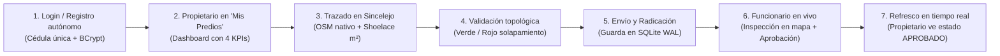

# 🎓 SIGCAT — Guía de Sustentación y Aportes por Integrante

**Proyecto:** SIGCAT (Sistema de Información Geográfica y Catastro Multipropósito de Sincelejo, Sucre)  
**Institución:** Universidad Antonio José de Sucre (UNIAJS)  
**Asignatura:** Ingeniería de Software | **Docente:** Ing. Juan Manuel Palacio  
**Tecnología Base:** 100% Java Nativo (Java 17 LTS + JavaFX 21 + SQLite)  

---

> 📌 **¿Cómo usar este documento?**  
> Este documento está diseñado para preparar la sustentación del proyecto frente al profesor. Para cada uno de los 5 integrantes encontrarás:
> 1. **Ficha Técnica y Profesional:** Para el informe escrito, memoria técnica o preguntas profundas de código.
> 2. **Guion de Sustentación Oral (Primera Persona):** Texto en lenguaje claro, natural y seguro para hablar frente al docente sin trabarse ni memorizar tecnicismos innecesarios.

---

## 1. 🏗️ Cristian Morales — Arquitecto de Software y Coordinador Técnico

### 📋 Aporte Técnico y Profesional (Informe / Memoria)
- **Diseño Arquitectónico del Sistema:** Definición del patrón arquitectónico en capas (MVC + DAO + Capa de Utilidades) asegurando desacoplamiento y mantenibilidad.
- **Estrategia Multi-PC y Concurrencia:** Configuración del motor de persistencia SQLite mediante `DatabaseConnection.java` implementando `PRAGMA journal_mode = WAL` (Write-Ahead Logging) y `PRAGMA busy_timeout = 5000` para soportar múltiples computadores conectados a la misma base de datos en red local sin bloqueos.
- **Gestión de Ventana y Navegación sin Parpadeo:** Creación de `ViewNavigator.java`. Solucionó el problema de cambios bruscos de resolución al navegar entre pantallas reemplazando la raíz visual (`scene.setRoot()`) en lugar de recrear objetos `Scene`, manteniendo la ventana maximizada (`stage.setMaximized(true)`).
- **Seguridad Criptográfica (RNF-01):** Implementación de `PasswordUtil.java` con algoritmo BCrypt factor de costo 12 y migración automática transparente en `DatabaseInitializer.java`.
- **Empaquetado y Distribución:** Configuración de Maven Shade Plugin y `MainLauncher.java` para generar un Fat JAR autónomo ejecutable (`SIGCAT-1.0-SNAPSHOT-fat.jar`) sin dependencias externas de entorno.

---

### 🎙️ En Palabras Simples (Guion Oral para Cristian)
> *"Profesor, mi nombre es Cristian Morales y fui el Arquitecto de Software del proyecto. Mi responsabilidad principal fue garantizar que todas las piezas del sistema encajaran perfectamente, que el software fuera seguro y que funcionara de manera estable en un entorno real con varias computadoras.*  
>  
> *En concreto, resolví tres retos fundamentales:*  
> *Primero, la arquitectura multi-PC: logramos que la aplicación se pueda conectar en red local entre varios computadores (uno para el funcionario y otros para los ciudadanos) configurando SQLite en modo WAL y con resolución dinámica de rutas, para que no se bloquee cuando varios usuarios guarden datos al tiempo.*  
>  
> *Segundo, la experiencia de usuario y navegación: antes las pantallas cambiaban de tamaño o parpadeaban al pasar de una vista a otra; creé un componente llamado `ViewNavigator` que reutiliza la misma escena y mantiene la ventana maximizada como en cualquier aplicación comercial profesional.*  
>  
> *Y tercero, la seguridad: ninguna contraseña se guarda en texto plano; implementé el cifrado con BCrypt factor de costo 12, cumpliendo con los estándares de ciberseguridad exigidos."*

---

## 2. 📐 Andrés Diaz — Desarrollador Core y Lógica Espacial

### 📋 Aporte Técnico y Profesional (Informe / Memoria)
- **Motor de Métricas Geométricas:** Implementación de `ShoelaceCalculator.java` basado en la Fórmula del Área de Gauss para polígonos cerrados arbitrarios, cálculo de perímetro acumulado euclidiano y centroide geométrico para posicionamiento de etiquetas.
- **Proyección Métricas Reales ($m^2$ y $m$):** Implementación del conversor geodésico local (`convertirAVerticesMetros()`). Convierte las coordenadas angulares WGS84 (`[lon, lat]`) a distancias métricas ortogonales basadas en la latitud de Sincelejo ($\approx 9.30^\circ$), logrando que el área calculada y guardada en base de datos refleje metros cuadrados reales y no unidades arbitrarias de pantalla.
- **Motor de Validación Topológica:** Desarrollo de `SolapamientoValidator.java` en Java puro con cuatro niveles de verificación:
  1. *Filtro Rápido por Bounding Box:* Descarta comparaciones innecesarias si las cajas envolventes no se tocan.
  2. *Intersección Estricta de Segmentos:* Detección de colisiones de linderos mediante producto cruzado y orientación de vectores.
  3. *Detección de Autointersecciones:* Detección preventiva si el usuario dibuja un polígono complejo en "forma de 8".
  4. *Algoritmo de Ray-Casting:* Comprobación de inclusión total de un predio dentro de otro.
- **Lógica de Dictamen del Funcionario:** Reglas de validación para aprobación y exigencia de justificación técnica obligatoria en caso de rechazo.

---

### 🎙️ En Palabras Simples (Guion Oral para Andrés)
> *"Profesor, mi nombre es Andrés Diaz y me encargué del núcleo matemático y topológico del sistema, lo que hace que SIGCAT sea realmente un software catastral y no un simple programa de dibujo.*  
>  
> *Lo que desarrollé se resume en dos cerebros lógicos:*  
> *El primero es el cálculo real de superficie: cuando el usuario dibuja sobre el mapa de Sincelejo, los clics son grados de latitud y longitud. Yo implementé una conversión matemática que proyecta esos grados a metros reales según la posición geográfica de Sincelejo, y mediante el Algoritmo de Shoelace calculamos los metros cuadrados exactos del terreno y su perímetro.*  
>  
> *El segundo cerebro es el validador topológico: el sistema no permite que una persona invada el lote de un vecino ni que dibuje linderos cruzados en forma de ocho. En tiempo real, el motor analiza matemáticamente si las líneas se cortan o si el polígono cae dentro de otro ya aprobado, pintando el terreno de rojo si hay invasión o de verde si el terreno es válido y legal."*

---

## 3. 🎨 Leider Barreto — Desarrollador UI/UX y Motor Cartográfico

### 📋 Aporte Técnico y Profesional (Informe / Memoria)
- **Motor Cartográfico OpenStreetMap 100% Nativo:** Desarrollo de `OsmTileManager.java`. Renderiza mapas de OpenStreetMap directamente sobre un `Canvas` de JavaFX sin utilizar WebViews, JavaScript ni HTML.
- **Algoritmo de Teselas y Caché Concurrente:** Implementación de la proyección Web Mercator (EPSG:3857) para convertir `[lat, lon]` a coordenadas de teselas `(x, y, zoom)`. Descarga asíncrona multihilo con `ExecutorService` (hilos daemon) y memoria caché `ConcurrentHashMap` para navegación instantánea.
- **Interacción y Georreferenciación Bidireccional:**
  - Conversión dinámica `screenPixelToGeo()` (clic de pantalla a WGS84) y `geoToScreenPixel()` (coordenadas geográficas a píxeles de pantalla).
  - Paneo fluido arrastrando con el ratón (`isDragging` y cursor `CLOSED_HAND`).
  - Zoom dinámico con la rueda del ratón centrado en pantalla.
  - Anclaje geográfico: los polígonos quedan fijados a las calles de Sincelejo sin moverse ni deformarse al desplazar o ampliar el mapa.
- **Vistas JavaFX y Diseño Gráfico (CSS):** Creación de interfaces modernas con tema oscuro en `main.css`:
  - `login.fxml`: Hero Split institucional.
  - `registro.fxml`: Formulario autónomo con feedback visual.
  - `menu-propietario.fxml`: 4 tarjetas KPI, tabla interactiva y botón *"🗺️ Ver en Mapa"*.
  - `menu-funcionario.fxml`: Consola de revisión y dictamen técnico.
  - `dibujo.fxml`: Lienzo cartográfico adaptable que se expande con la ventana.

---

### 🎙️ En Palabras Simples (Guion Oral para Leider)
> *"Profesor, mi nombre es Leider Barreto y fui el encargado de la interfaz gráfica y del motor del mapa interactivo.*  
>  
> *Uno de los requisitos más exigentes del proyecto era que debía ser 100% Java puro, sin usar navegadores embebidos ni páginas web de fondo. Por eso desarrollé un motor cartográfico nativo que se conecta directamente a los servidores de OpenStreetMap, descarga las imágenes de las calles de Sincelejo en segundo plano y las dibuja sobre un Canvas de JavaFX.*  
>  
> *Logramos que el usuario pueda desplazarse por Sincelejo arrastrando el mouse, hacer zoom con la rueda y saltar directamente a zonas reconocidas como la Universidad de Sucre, el Parque Santander o Majagual.*  
>  
> *Además, diseñé todas las pantallas con un estilo visual moderno y profesional: el panel del propietario donde ve sus predios con semáforo de colores (verde para aprobado, naranja pendiente, rojo rechazado), y la función para que tanto el propietario como el funcionario puedan hacer doble clic en cualquier solicitud y el mapa vuele automáticamente a centrarse en el predio."*

---

## 4. 💾 Aldo Ibañez — Desarrollador de Persistencia y Base de Datos

### 📋 Aporte Técnico y Profesional (Informe / Memoria)
- **Modelo Relacional de Base de Datos:** Diseño del esquema relacional en SQLite con tablas normalizadas (`usuarios`, `predios`, `vertices`), claves foráneas, restricciones de integridad referencial (`ON DELETE CASCADE`) y columnas virtuales generadas.
- **Capa DAO Transaccional ACID:** Implementación de `PredioDAO.java` y `VerticeDAO.java`:
  - Guardado en lote (*batch processing*) con `addBatch()` y `executeBatch()` para optimizar la inserción de vértices en disco.
  - Manejo manual de transacciones con `setAutoCommit(false)`, `commit()` y `rollback()`, asegurando que si ocurre un fallo nunca quede un predio guardado a medias o con vértices huérfanos.
- **Malla Catastral Oficial y Filtros de Estado:** Consultas optimizadas con ordenamiento y filtros por estado (`PENDIENTE`, `APROBADO`, `RECHAZADO`). Separación estricta de la malla topológica oficial (únicamente predios aprobados) para evitar falsos solapamientos con borradores en trámite.
- **Triggers y Mapeo de Entidades:** Implementación de consultas parametrizadas con `PreparedStatement` para prevenir inyecciones SQL y mapeo bidireccional entre `ResultSet` y objetos POJO (`Predio`, `Usuario`, `Vertice`).

---

### 🎙️ En Palabras Simples (Guion Oral para Aldo)
> *"Profesor, mi nombre es Aldo Ibañez y fui el responsable de la persistencia y la base de datos de SIGCAT.*  
>  
> *Mi trabajo consistió en diseñar cómo se almacena toda la información del catastro y garantizar que los datos nunca se dañen ni se pierdan.*  
>  
> *Implementé el patrón DAO de forma transaccional: cuando un ciudadano radica un terreno, el sistema no solo guarda el nombre y la dirección, sino toda la lista de coordenadas de sus esquinas. Utilicé transacciones ACID, lo que significa que si por alguna razón falla el guardado de un solo vértice, el sistema revierte automáticamente la operación para que la base de datos nunca quede corrupta con terrenos deformes o incompletos.*  
>  
> *También optimicé las consultas de la malla catastral: el mapa solo carga como obstáculos los terrenos que los funcionarios ya han aprobado oficialmente, evitando confusiones con solicitudes que apenas están en revisión."*

---

## 5. 🧪 José Sánchez — Analista de Calidad (QA) y Pruebas Automatizadas

### 📋 Aporte Técnico y Profesional (Informe / Memoria)
- **Estrategia y Suite de Pruebas Automatizadas:** Diseño e implementación de una suite de 25 pruebas automatizadas ejecutadas bajo el framework **JUnit 5**, logrando un 100% de éxito (`BUILD SUCCESS`).
- **Pruebas Unitarias de Geometría (`ShoelaceCalculatorTest.java` - 4 tests):** Verificación de cálculos de superficie en polígonos regulares e irregulares, invariancia de orden de vértices (sentido horario vs. antihorario) y validación de excepciones ante figuras degeneradas (menos de 3 vértices).
- **Pruebas Unitarias de Conflicto Espacial (`SolapamientoValidatorTest.java` - 3 tests):** Cobertura de solapamientos parciales, inclusión total (un lote dentro de otro) y garantía de colindancia pacífica (lotes adyacentes que comparten lindero sin solaparse).
- **Pruebas de Acceso a Datos y Seguridad (`UsuarioDAOTest.java` - 10 tests, `PredioDAOTest.java` - 4 tests):** Verificación de unicidad de documentos, persistencia transaccional y validación criptográfica de contraseñas con hash BCrypt.
- **Pruebas de Integración End-to-End (`FlujoAprobacionIntegrationTest.java` - 4 tests):** Simulación integral del ciclo de vida catastral: radicación del predio $\rightarrow$ cálculo de área $\rightarrow$ estado PENDIENTE $\rightarrow$ dictamen del funcionario $\rightarrow$ transición a APROBADO o RECHAZADO con trazabilidad de observaciones.

---

### 🎙️ En Palabras Simples (Guion Oral para José)
> *"Profesor, mi nombre es José Sánchez y mi rol fue el Aseguramiento de Calidad y Pruebas (QA).*  
>  
> *Mi misión fue comprobar que el software no se rompa bajo ninguna circunstancia y que los cálculos sean matemáticamente exactos antes de presentárselo a usted.*  
>  
> *Construí una batería de 25 pruebas automatizadas con JUnit 5 que se ejecutan directamente con Maven. Estas pruebas verifican automáticamente:*  
> *1. Que las fórmulas de cálculo de área den resultados matemáticamente exactos.*  
> *2. Que el validador detecte correctamente los solapamientos ilegales, pero que permita que dos vecinos compartan la misma cerca sin dar falsas alarmas.*  
> *3. Que las contraseñas realmente se verifiquen con el algoritmo seguro BCrypt.*  
> *4. Y el flujo completo: simulé en código que un usuario radica un lote, entra al sistema, el funcionario lo revisa y lo aprueba, comprobando que todo el ciclo de vida se complete sin errores.*  
>  
> *El resultado es que todas las 25 pruebas del proyecto pasan en verde al 100%."*

---

## 🌟 Resumen de la Demostración en Vivo (Para Guiar la Presentación)

Para demostrar que todo lo dicho funciona en tiempo real frente al docente, sigan este orden:

1. **Paso 1 (Registro y Login):** Mostrar la pantalla de Login con el split moderno. Iniciar con el usuario propietario `2002` / `123` o registrar uno nuevo.
2. **Paso 2 (Portal del Propietario):** Mostrar los 4 KPIs en tiempo real y la tabla "Mis Predios".
3. **Paso 3 (Lienzo Cartográfico OSM):** Abrir *"➕ Radicar / Dibujar Nuevo Predio"*. Mostrar cómo el mapa se mueve fluidamente, seleccionar el *"Sector Norte (Universidad de Sucre)"* y trazar un lote sobre la universidad.
4. **Paso 4 (Métricas y Solapamiento):** Mostrar cómo el área se actualiza dinámicamente en metros cuadrados reales ($m^2$). Simular una invasión de lindero para ver la alerta roja y corregirla a verde.
5. **Paso 5 (Radicación):** Guardar el predio con nombre y dirección. Volver a "Mis Predios" y ver cómo aparece en estado `PENDIENTE` en color naranja.
6. **Paso 6 (Funcionario y Dictamen):** Iniciar sesión en la otra ventana o equipo como Funcionario (`1001` / `123`). Ver la solicitud en la bandeja, pulsar *"🗺️ Inspeccionar en Mapa"* o hacer doble clic para ver cómo el visor vuela automáticamente a centrarse en el terreno en la Universidad. Escribir el dictamen y dar clic en *"Aprobar Predio"*.
7. **Paso 7 (Sincronización):** Regresar a la vista del propietario: en menos de 4 segundos la tabla se auto-refresca sola mostrando el lote en verde con estado `APROBADO` y el mensaje oficial del funcionario.
